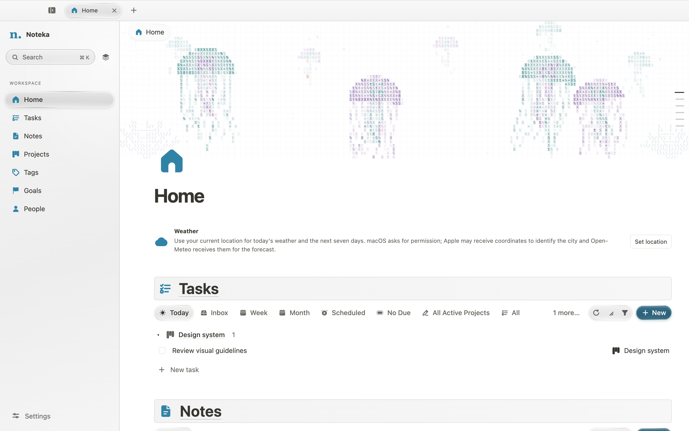
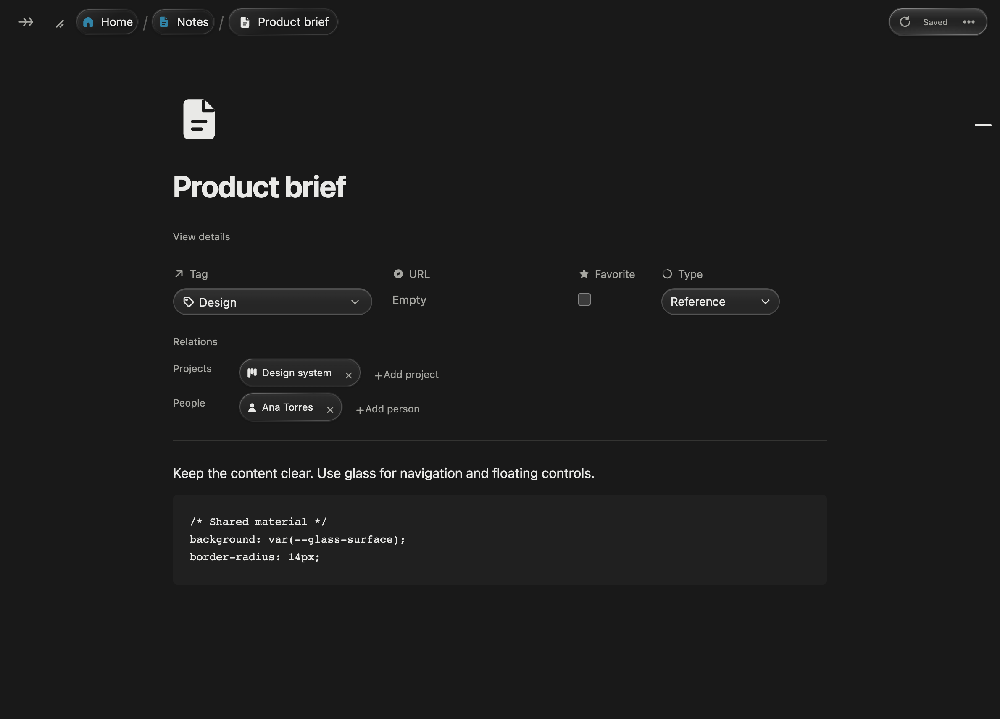
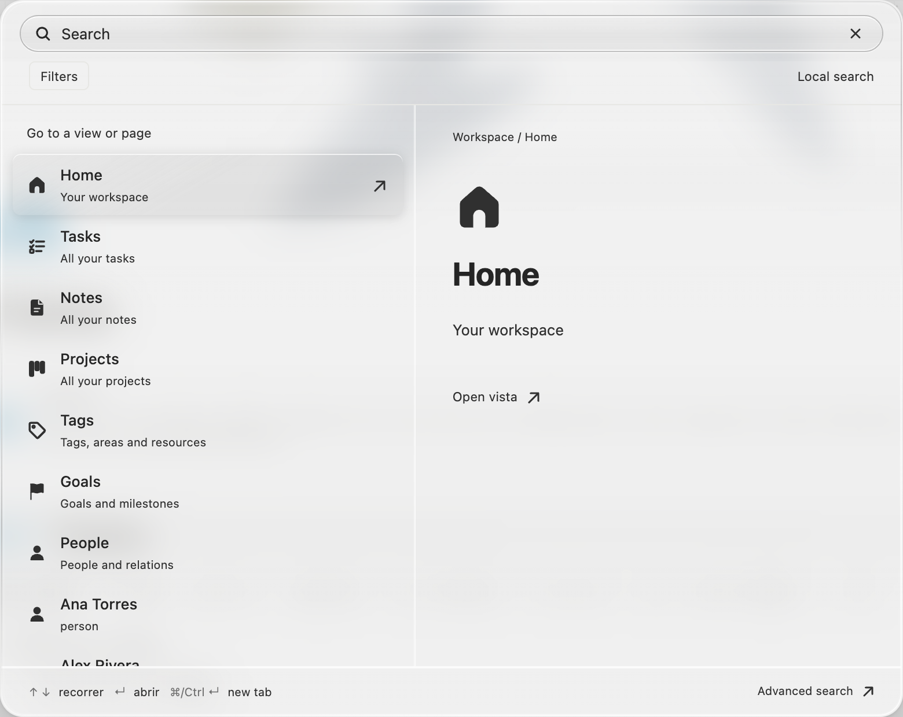

# Design system de Noteka

Guía obligatoria para crear o modificar pantallas. La implementación vigente está
en `src/style.css` y en los componentes de `src/lib/`; este documento define las
decisiones compartidas. Si una pantalla necesita apartarse de ellas, registrá
el motivo en su cambio de OpenSpec y actualizá esta guía junto con el código.

Referencia consolidada de Liquid Glass al **04/11/2026**. Esta guía y la
[galería de capturas](design/liquid-glass/README.md) permiten continuar el diseño
sin consultar el chat. Las capturas ilustran el resultado; los tokens y estados
del código son la fuente para implementarlo. Los documentos de verificación
registran pruebas y límites, no recetas alternativas.

## Cómo continuar el diseño con otra IA

1. Leé `AGENTS.md`, [plan](plan-noteka.md), [workflow](openspec-workflow.md), esta
   guía y el cambio OpenSpec correspondiente. No implementes propuestas
   pendientes como si fueran comportamiento vigente.
2. Identificá si el componente es contenido, navegación, campo o superficie
   flotante. Elegí una receta existente de la matriz siguiente; no apliques el
   mismo vidrio elevado a todos los elementos.
3. Revisá el componente dueño en `src/lib/` y las reglas finales de
   [src/style.css](../src/style.css). La hoja conserva reglas base y overrides:
   inspeccioná el estilo calculado, no sólo la primera coincidencia del selector.
4. Reutilizá clases, tokens, iconos y acciones existentes. Cambiá material y
   marco sin reimplementar persistencia, foco, guardias, menús o navegación.
5. Contrastá el resultado con las capturas de ambos temas, verificá los estados
   de esta guía y actualizá documento y galería si cambia una decisión compartida.

Para una IA, la instrucción mínima es: «Aplicá `docs/design-system.md` y su
galería. Reutilizá los tokens `--glass-*` y los componentes existentes; mantené
contenido sólido, vidrio neutro, acciones teñidas con contraste verificado y
fallbacks accesibles. Verificá claro/oscuro, teclado, bloqueo y ancho estrecho».

## Carácter visual

Noteka usa una interfaz de contenido sobria con controles inspirados en vidrio
de macOS. El contenido manda: notas, listas, formularios, tarjetas y editores
mantienen fondos sólidos para leer y escribir. El vidrio se reserva para la
navegación y las superficies que flotan sobre contenido. Los fondos son neutros;
el color primario elegido en Settings identifica foco, iconos y acciones. Los
colores semánticos (error, advertencia, estados de proyectos) conservan su
significado y no se usan como decoración del vidrio.

La ventana Tauri actual es opaca. El material CSS no muestra el escritorio ni
reproduce la refracción de Liquid Glass nativo. No agregues una imagen de fondo
solo para que el vidrio parezca más visible.

## Superficies y tokens

`src/style.css` define `--bg`, `--surface`, `--text`, `--muted`, `--border`,
`--accent`, `--focus` y `--selected` por tema. El acento personalizado se calcula
en `src/lib/primary-color.ts`. Para overlays, reutilizá `--glass-surface`,
`--glass-search-surface`, `--glass-breadcrumb-surface`, `--glass-breadcrumb-rim`,
`--glass-breadcrumb-sheen`, `--glass-stroke` y `--glass-blur`. La navegación
comparte la óptica de `--glass-sidebar-*` con las variantes `--glass-nav-*`,
`--glass-crumb-shadow` y `--glass-action-*`. No copies colores
hexadecimales del material a componentes nuevos.

| Nivel | Uso | Tratamiento |
| --- | --- | --- |
| Contenido | Notas, Tasks, Projects, Boards, formularios, tablas y tarjetas | Fondo sólido `--bg` o `--surface`; texto con `--text` y `--muted`. |
| Navegación persistente | Barra superior y sidebar | Gradientes neutros estáticos, borde fino y selección neutra; sin `backdrop-filter` grande. |
| Superficie flotante | Búsqueda, menús, picker, tooltip visible y diálogo pequeño | Material translúcido `--glass-surface`, borde `--glass-stroke`, sombra exterior e interior; filtro local `--glass-blur` si el WebView lo admite. |
| Popup de ajustes | Settings | Material compartido con Search, navegación translúcida y velo de lectura más denso en el contenido; un filtro local mientras está abierto. |
| Side peek | Lectura/edición en paneles | Marco y navegación con acabado neutro; cuerpo documental sólido. |

La barra de formato abierta del editor usa el tratamiento estático de
navegación; las herramientas de selección y los menús de bloques flotantes usan
el material de overlay.

Search y Settings comparten `.glass-popup`, `--glass-search-surface` y
`--glass-popup-sheen`: tinte neutro, reflejo tenue, borde luminoso al 80% y
reflejo interior al 45%, con `blur(16px) saturate(1.35)` local. El tinte claro
usa 56% y el oscuro 72%; se evita superponer otro radial blanco denso. Resultados,
preview y navegación usan `--glass-popup-navigation`; Settings protege su
contenido con `--glass-popup-content`, un velo algo más denso. Los hijos no
agregan filtros. La transmisión del fondo y el contraste se verifican sobre
píxeles compuestos, no sólo leyendo el alfa. Con transparencia reducida o
contraste aumentado, paneles y capas vuelven a superficies sólidas sin reflejos
ni filtros. La búsqueda se abre como diálogo modal: el
clic en el backdrop la cierra y los clics dentro del panel no. Mientras está
abierta, la portada ASCII de Home sigue animando; `blocked` desactiva los
controles del fondo, no el canvas. La portada ASCII comparte el fondo de Home
para evitar una línea de color al terminar el canvas; la portada fotográfica
conserva su propia imagen.

Los campos Search de ambos popups repiten `--glass-field-*` del acceso lateral:
cápsula de 32 px, borde fino, padding único, fuente de 13 px a peso 400 y
reflejos interiores, con anillo exterior al enfocar. El placeholder es Search;
los nombres accesibles específicos y la semántica del combobox se conservan.
La tinta neutra se adapta a la superficie del popup para lectura y los cierres
se integran como botones circulares. Settings usa la misma cápsula en su
búsqueda, selección de navegación con marco del sidebar y cierre circular.

La guardia de cambios pendientes usa `.glass-popup` con
`--glass-confirm-surface`, un tinte algo más denso (69% claro/76% oscuro) para
leer su decisión y errores. Cancel/Discard son cápsulas neutras
`.glass-secondary`; Save and continue y Save/Retry de cabecera usan
`.glass-action.primary`, con los tokens de New, texto/atajo blancos, borde al
75% y reflejo al 50%. Guardado conserva 28 px mínimos en cabecera y 36 px en
la guardia; en ancho estrecho los secundarios comparten fila y la confirmación
ocupa la siguiente. El estado Unsaved changes conserva su señal semántica.
El backdrop de la guardia no resuelve la decisión: Cancel/Escape, Discard y
Save mantienen sus operaciones. Los fallbacks retiran reflejos/filtros y usan
tinte primario o neutro sólido con foco visible.

Los menús de página/apertura/bloques, iconos, relaciones y paneles flotantes
PageTools usan `.glass-menu`: radio compartido de 14 px, borde anular del
sidebar al 60%, reflejo interior al 35% y `--glass-menu-shadow`. La clase define
el material; el componente dueño conserva posición, foco, scroll y cierre.
Los paneles PageTools en el flujo de la página conservan su tratamiento propio.
El desenfoque local existente queda en la superficie abierta. Con transparencia
reducida o contraste aumentado, el marco es sólido, con borde definido y sin
reflejos, sombras ni filtros.

Los breadcrumbs no llevan una barra opaca propia ni reservan una fila: la barra
flota sobre el contenedor de scroll de Home y de las vistas de sección, de modo
que el contenido pasa por debajo de las cápsulas. Las migas navegables son
botones; la miga actual conserva `aria-current="page"` y no se convierte en un
control sin acción. Las cápsulas usan vidrio claro: tinte neutro mínimo, brillo
superior y desenfoque local corto de 3 px. Comparten el borde direccional del
sidebar al 25% de opacidad y su reflejo interior al 30%, con sombra corta; su
contorno es más tenue que el de las selecciones de navegación. Con
contraste aumentado se restituye un borde sólido para mantener la legibilidad. La portada ASCII admite una
cápsula un paso más transparente; la fotográfica usa el vidrio claro general.
El desenfoque y el ajuste de contraste se limitan a cada cápsula; con menor
transparencia o mayor contraste se usa un fondo sólido. El texto conserva una
sombra local para separarse del contenido que pasa por debajo. El contraste se
garantiza sobre el fondo de página medido; sobre contenido claro u oscuro en
movimiento el contraste local puede bajar, y la preferencia de transparencia
reducida restituye la superficie sólida. El efecto CSS no desplaza píxeles como
el material nativo. En páginas de detalle, la barra del breadcrumb también es
transparente y sus acciones se agrupan en una cápsula de vidrio local con el
material de overlay para mantener la legibilidad de los controles. Al volver por
una miga anterior, las migas de la derecha se desplazan y se funden en la elegida
con una transición suave; la miga destino hace un pop. Al entrar desde Home a una
sección, la miga de nivel 2 nace desde la miga Home y se desliza hasta su lugar
con la misma transición. Con movimiento reducido la animación se desactiva.

En el sidebar, sólo la sección activa usa la cápsula de vidrio; las demás filas
no llevan fondo persistente y el hover se limita a `--hover`. La cápsula activa
usa `--glass-sidebar-active`, un tinte gris translúcido más presente que el
breadcrumb. El experimento `refine-sidebar-liquid-glass` incorpora
`--glass-sidebar-sheen`, `--glass-sidebar-rim`, `--glass-sidebar-shadow` y
`--glass-sidebar-inner-rim`: reflejos estáticos, un contorno luminoso direccional
de 1 px y una sombra exterior corta con relieve interior. El material es neutro
en ambos temas; el acento permanece en los iconos. No lleva `backdrop-filter`,
porque el fondo del sidebar es estático. Es un indicador único que se desplaza
entre filas con la transición elástica existente; con movimiento reducido el
cambio es inmediato. Con transparencia reducida o contraste aumentado, la
cápsula vuelve a `--hover` sólido con borde `--border`, sin reflejos ni sombras.
El contraste se verifica sobre píxeles compuestos del interior, ocultando sólo
las etiquetas y el diálogo durante la captura de prueba; no sobre el tinte RGBA
aislado. El usuario aceptó este acabado y solicitó extenderlo a los controles
de navegación y creación mediante `extend-liquid-glass-controls`.

La pestaña superior activa comparte el tinte neutro, borde al 65% y reflejo
interior al 60%, con menos sombra que el sidebar. Mantiene 32 px de alto, forma
de cápsula y espacio alrededor dentro del contenedor de tabs para no recortar
el brillo. Las pestañas inactivas conservan una presentación secundaria. Los
controles + y × mantienen tamaño y acción, con fondo circular de vidrio sólo
en hover o foco de teclado. Al presionar, el relieve pasa a una sombra interior
sin desplazar el control ni alterar las transiciones de navegación.

El acceso Search del sidebar usa una cápsula de campo más plana: tokens
`--glass-field-*`, tinte gris neutro, borde fino de 1 px y luces interiores
superior/inferior sin sombra exterior elevada ni blur. Conserva 32 px de alto,
icono, etiqueta, atajo y apertura del buscador; el texto y el atajo usan tinta
neutra legible. Hover refuerza discretamente el tinte y la presión usa sombra
interior. El foco mantiene el anillo de la app. En ancho estrecho se oculta el
atajo y la etiqueta conserva truncado; transparencia reducida o contraste alto
restablecen fondo sólido y borde definido, sin reflejos. El control sigue
siendo un botón, no un campo editable dentro del sidebar.

Las tabs de vista de las páginas de sección (Tasks, Notes, Projects, Tags, Goals,
People y Milestones) comparten un único indicador deslizante con una curva
elástica más contenida que la del sidebar. La tab activa no pinta su propio
fondo: el indicador usa el mismo tinte neutro, borde y reflejos que la pestaña
superior activa, con sombra corta; se desplaza y se redimensiona con el ancho
de la nueva tab. El
indicador vive en el toolbar, fuera del contenedor con scroll, para que la sombra
no se recorte; sigue a la tab activa y se oculta si queda fuera del área visible.
El icono de la tab clickeada reproduce el mismo Jelly de un ciclo que el sidebar,
con un wrapper genérico que conserva su figura. Con movimiento reducido el cambio
es inmediato y con transparencia reducida el indicador vuelve a una superficie
sólida.

Las acciones de icono de Tasks, Notes, Projects, Tags, Goals, People y Milestones
se agrupan en `.glass-tool-group`, una cápsula neutra de 32 px con el borde y
reflejos compartidos. El estado de lectura y New quedan fuera del grupo. Los
botones conservan 28 px, nombres accesibles y orden de teclado; hover/foco se
identifican dentro de la cápsula. No apliques blur al grupo: los menús de posición
fija necesitan conservar su bloque contenedor. En ancho estrecho, las acciones
mantienen el ajuste de fila existente.

ASCII/Photo usa una cápsula segmentada, con material de campo en el marco e
indicador neutro deslizante de la misma acción compartida por las vistas. Los
botones conservan `aria-pressed`, elección persistida y foco visible; la cápsula
aparece al pasar el cursor o enfocar. El selector sigue anclado en posición
absoluta a la portada. Movimiento reducido elimina la transición y menor
transparencia/mayor contraste restablecen superficies sólidas.

Las tarjetas de People mantienen foto y datos sobre `--bg` sólido. El marco
comparte el borde direccional al 35% y reflejo interior al 20%, con radio de
16 px en galería/pipeline y 12 px en filas compactas. Hover/foco refuerzan
el marco al 60%/35% y revelan un sheen tenue detrás del contenido, sin blur,
traslación ni cambios de densidad. El foco de teclado se dibuja fuera de la
tarjeta para que el recorte de la foto no lo oculte. Se conservan los colores
semánticos de relaciones y la imagen original.

Las relaciones vinculadas usan cápsulas compactas con
`--glass-content-surface`, `--glass-content-sheen` y `--glass-card-shadow`.
Icono/nombre y × son botones independientes; el cierre tiene área circular de
26 px. Los nombres largos pueden envolver y Add conserva jerarquía secundaria,
con material de campo sólo en hover/foco. El estado bloqueado deshabilita la
edición, manteniendo acceso a los destinos. Contraste aumentado/transparencia
reducida eliminan reflejos y sombras en tarjetas y cápsulas.

Tag de Note agrupa destinos y edición dentro de un marco de campo de 32 px
con un destino o vacío, con extremos redondeados y chips internos planos.
La lista de destinos envuelve por separado; la flecha tiene ancho reservado y
no salta a otra fila. Los nombres individuales se truncan con tooltip; varias
etiquetas pueden añadir filas. Type conserva el
select HTML y su desplegable nativo con cápsula de campo y flecha decorativa
sin eventos (`appearance: none` normaliza el marco en WebKit); URL permanece como texto de lectura y
Favorite como checkbox real. El bloqueo conserva el material y opacidad del
marco de Tag/Type; sólo atenúa la tinta de los controles inhabilitados. Los
destinos Tag siguen legibles porque su apertura continúa habilitada.
La cabecera de Note reúne bloqueo temporal,
refresco, estado, Save/Retry y menú en una cápsula neutra de esquinas de 18 px,
con borde al 50% y reflejo al 35%. Mantiene el ajuste de fila en paneles
estrechos y no aplica blur al ancestro de menús fixed. Las otras páginas de
detalle conservan su composición. Los fallbacks sólidos retiran sombras y
gradientes sin alterar controles, etiquetas ni guardias.

## Componentes e interacción

### Matriz de implementación

Los valores de alto son los del control, no un permiso para aumentar la fila.
Los radios de cápsula usan `999px`, salvo Tag con `16px` para admitir varias filas.

| Componente | Medida y material | Dueño / patrón |
| --- | --- | --- |
| Selección lateral | Fila 34 px, gap 4 px; tinte sidebar; sin blur | `App.svelte`, `.sidebar-nav-indicator`; un único indicador |
| Pestaña superior | Alto 32 px; tinte nav, selección neutra | `App.svelte`, `.workspace-tab.active`; +/× sólo elevan en hover/foco |
| Breadcrumb | Cápsulas independientes, blur 3 px; sombra corta | `PageBreadcrumb.svelte`; barra transparente sobre scroll |
| Vistas de sección y Collections | Indicador ajusta posición y tamaño; sin blur, alojado fuera del área desplazable | `sliding-tabs.ts`, `.sliding-tabs-indicator`; no duplicar fondo activo |
| Herramientas | Grupo 32 px, botones 28 px; sin blur | `Home*Section.svelte`, `MilestonesPanel.svelte`, `.glass-tool-group` |
| New | Cápsula teñida con texto blanco e ícono `+` de 16 px | `.task-new.primary`; fuera del grupo de herramientas |
| Search lateral | 32 px, fuente 13 px, gap 8 px, padding horizontal 11 px | `.sidebar-search`, botón que abre Search |
| Search en popups | Misma geometría/tipografía; input interior 30 px sin padding extra | `SearchDialog.svelte`, `SettingsDialog.svelte`; cierres 24 px |
| ASCII/Photo | Marco de campo, botones 24 px, indicador nav | `HomePanel.svelte`, acción `slidingTabs`; visible en hover/foco |
| People | Fondo sólido; radio 16 px galería/pipeline, 12 px lista | `HomePersonSection.svelte`, `.person-card` |
| Relaciones | Cápsulas que admiten nombres largos; × de 26 px | `WorkspacePane.svelte`, `.relation-chip-wrap`; dos botones separados |
| Tag/Type de Note | 32 px con un valor/vacío; marco de campo | `NotePageProperties.svelte`; Tag envuelve lista, Type conserva select HTML |
| Cabeceras de detalle | Radio 18 px, gap 4 px, padding 2 px 5 px; sin blur | `WorkspacePane.svelte`, `.note-page-actions`; Refresh, estado, guardado y menú |
| Save/Retry | Cápsula teñida, mínimo 28 px en cabecera | `.glass-action.primary`; atajo blanco, estado por separado |
| Menús/pickers | Radio 14 px, material overlay, blur local 10 px existente | `.glass-menu`; PageTools, PeekModeMenu, BlockEditor, IconPicker, RelationPicker |
| Calendario de Due (Task) | Panel ≤ 292 px, días 30 px; material de menú con blur 10 px | `DueDatePicker.svelte`; anclaje debajo/arriba del botón Due, evento propio |
| Search popup | 780 × 620 px, limitado por viewport; radio 20 px | `.context-search.glass-popup`; filtro único 16 px |
| Settings | 1000 × 640 px, limitado por viewport; radio 20 px | `.settings-dialog.glass-popup`; velo de lectura más denso en panel principal |
| Guardia y Move project | Radio 20 px, material confirmación; botones mínimos 36 px | `.glass-popup`, `.glass-secondary`, `.glass-action.primary` |
| Calendario de cumpleaños | Grupo 32 px con controles interiores de 28 px; calendario sólido | `HomePersonSection.svelte`, `.birthday-tools` |
| Campos cortos | 32 px; material de campo, controles HTML y etiquetas existentes | `.glass-field`, propiedades y relaciones compactas |
| Bienvenida | Campo de path compacto; acciones mínimas de 36 px | `App.svelte`, `.glass-field`, `.glass-action`, `.glass-secondary` |

Los límites responsivos y el layout exacto pertenecen al CSS vigente. A 420 px
ninguna acción debe quedar fuera del viewport ni introducir scroll horizontal
global. El contenido puede seguir usando scroll vertical local.

### Recetas de material y borde

El efecto surge de **tinte + sheen estático + borde direccional + relieve**.
El blur se suma sólo cuando hay contenido detrás que conviene difuminar.
Subir el blur o poner blanco opaco no reproduce la receta del sidebar.

| Familia de tokens | Claro / oscuro actual | Uso |
| --- | --- | --- |
| `--glass-sidebar-active` | `#bcbcbc70` / `#7373734d` | Selección lateral, alfa aproximado 44% / 30% |
| `--glass-nav-surface` | `#bcbcbc4d` / `#7373733d` | Tabs y grupos, 30% / 24% |
| `--glass-surface` | `#f7f7f7d9` / `#282828c7` | Menús y acciones de Note, 85% / 78% |
| `--glass-search-surface` | `#f7f7f78f` / `#1c1c1cb8` | Search/Settings, 56% / 72% |
| `--glass-confirm-surface` | `#f7f7f7b0` / `#1c1c1cc2` | Guardia, 69% / 76% |
| `--glass-breadcrumb-surface` | `#f7f7f785` / `#2828282e` | Migas, 52% / 18%; ASCII usa 48% / 12% |
| `--glass-field-surface` | `#d4d4d45c` / `#ffffff0f` | Campos, 36% / 6% |
| `--glass-content-surface` | `#bcbcbc24` / `#7373731f` | Relaciones, 14% / 12% |
| `--glass-popup-navigation` | `#ffffff29` / `#18181814` | Velo ligero de resultados/navegación |
| `--glass-popup-content` | `#ffffff4d` / `#18181829` | Velo más denso de lectura de Settings |

Estos valores documentan el estado actual. En código **referenciá el token**;
si cambia la receta, actualizá esta tabla junto con CSS y capturas. El alfa no
equivale a la transparencia visual final: los gradientes y velos se componen.

`--glass-sidebar-sheen` combina un radial inferior y un gradiente vertical.
`--glass-sidebar-rim` es un gradiente de 155° con cinco zonas: luz a 4%/24%,
sombra a 46%, transición a 62% y luz a 84%. No es un borde blanco uniforme.
`--glass-sidebar-shadow` da relieve a la selección principal;
`--glass-nav-shadow` lo reduce en controles secundarios;
`--glass-card-shadow` es aún más tenue para contenido sólido.
`--glass-field-*` tiene su propio borde y luces interiores, más planos.

La implementación compartida del borde usa `::before` absoluto con
`inset: 0`, `padding: 1px`, `border-radius: inherit`, fondo
`var(--glass-sidebar-rim)` y máscara de dos gradientes blancos:

```css
/* Anatomía existente en src/style.css; reutilizar el selector compartido. */
-webkit-mask: linear-gradient(#fff 0 0) content-box, linear-gradient(#fff 0 0);
mask: linear-gradient(#fff 0 0) content-box, linear-gradient(#fff 0 0);
-webkit-mask-composite: xor;
mask-composite: exclude;
```

`::after` usa `inset: 1.5px` y `var(--glass-sidebar-inner-rim)`.
Ambas capas tienen `pointer-events: none`. El componente conserva su propio
contexto de posición (`relative`, `absolute` o `fixed`); no cambies a `relative`
un menú fixed para agregarle el marco. Si incorporás una clase nueva, agregala
a los selectores compartidos de **ambas capas y sus fallbacks**. Las clases
existentes `.glass-menu`, `.glass-popup`, `.glass-action` y `.glass-secondary`
ya están incluidas. No sobrescribas pseudoelementos que tienen otra función.

| Control | `--glass-control-rim-opacity` | `--glass-control-inner-opacity` |
| --- | ---: | ---: |
| Sidebar activo | 1 | 1 |
| Tab / indicador de vista | .65 | .60 |
| Breadcrumb | .25 | .30 |
| Herramientas / cabecera Note / secundarios | .50 | .35 |
| Menús y pickers | .60 | .35 |
| People / relaciones | .35 | .20 |
| People hover/foco | .60 | .35 |
| Popup | .80 | .45 |
| New / Save / confirmación | .75 | .50 |
| + / × superiores en hover/foco | .55 | .40 |

No apliques el marco direccional elevado a Search/Tag/Type: comparten la
receta de campo, que es más plana. People conserva `--bg` sólido incluso
cuando su marco muestra reflejos.

### Reutilización práctica

Estos ejemplos muestran clases, no componentes nuevos ni handlers sustitutos:

```html
<div class="task-toolbar-actions glass-tool-group" role="group" aria-label="Task actions">
  <!-- Botones existentes, con sus nombres accesibles y handlers. -->
</div>
<!-- New queda fuera del grupo anterior. -->
<button class="primary task-new">New</button>

<!-- Mantener el elemento, rol, posición y foco del menú existente. -->
<div class="page-actions-menu glass-menu" role="menu">…</div>
<dialog class="settings-dialog glass-popup">…</dialog>

<button class="primary glass-action">Save <kbd>⌘S</kbd></button>
<button class="glass-secondary">Cancel</button>
```

`New` mantiene su clase existente; Save/Retry y Save and continue comparten
`.glass-action.primary`. El material teñido se deriva en
[primary-color.ts](../src/lib/primary-color.ts): `readable(color, '#ffffff', 7,
'light')` genera `--glass-action-tint`. La superficie usa 96% de ese tinte;
hover mezcla 94% de tinte con negro. El sheen es tenue para conservar el
contraste de texto y atajo blancos. La base 7:1 deja margen; el resultado
compuesto debe alcanzar al menos 4,5:1. No sustituyas el tinte por el acento
crudo ni atenúes el `<kbd>` por separado.

Search/Settings/guardia aplican `blur(16px) saturate(1.35)` **al panel abierto**.
Sus hijos agregan velos sin filtros. `::backdrop` sólo oscurece: claro
`#0000001f`, oscuro `#00000040`. La superficie base es sólida y el material
translúcido se habilita con `@supports`; el fallback de accesibilidad está
después. No introduzcas otra capa blanca densa que vuelva a tapar el fondo.

### Estados y contratos que el estilo debe conservar

| Estado | Resultado visual | Contrato funcional |
| --- | --- | --- |
| Reposo | Reflejos estáticos; inactivos secundarios | Sin timers ni animación de gradientes |
| Hover | Tinte/relieve algo más presente; primario algo más oscuro | Sin cambiar alto, padding o posición del control |
| Presión | `--glass-pressed-shadow` interior | Sin desplazamiento artificial |
| Foco | Con teclado, anillo exterior con `--focus`; con puntero, sin anillo de foco | La modalidad cambia al usar teclado o puntero; conservar selección, arrastre y foco accesible |
| Disabled | Tinta atenuada según control; marco de campo conservado | El atributo disabled y la operación siguen protegidos |
| Note bloqueada | Tag/Type con igual altura/material que al editar | Type y edición deshabilitados; destinos Tag/relaciones aún navegables |
| Saved | Estado neutro, sin crear una acción Save ficticia | Guardado explícito existente |
| Unsaved / error | Señal semántica de estado, Save o Retry teñido | Conservar borrador, error recuperable y atajo; no autosave por estilo |
| Guardia abierta | Cancel enfocado; secundarios neutros, Save destacado | Escape cancela; backdrop no decide; Discard y Save conservan sus rutas |
| Menor transparencia / mayor contraste | Fondos y bordes sólidos | Sin gradientes, rims, sombras ni blur; selección y foco siguen visibles |

Tag separa `.note-tag-list` (flex, `min-width: 0`, puede envolver) de su flecha
(`flex-shrink: 0`). El contenedor externo no envuelve. Un nombre largo se
trunca con tooltip; varios tags pueden aumentar el alto. No uses un contenedor
flex con envoltura compartida por texto y flecha: ese patrón produjo el Tag
innecesariamente alto de la revisión anterior. El bloqueo atenúa sólo la
edición, no la navegación a una etiqueta.

Type conserva `<select>` HTML con `appearance: none` y flecha decorativa sin
eventos. Esto normaliza su marco en WebKit y conserva el desplegable nativo.
Favorite sigue siendo checkbox real; URL sigue siendo texto de lectura.
En relaciones, nombre y × no se anidan como botones entre sí.

### Movimiento

| Interacción | Receta vigente |
| --- | --- |
| Indicador lateral | `transform`, 280 ms, `cubic-bezier(.3, 1.45, .5, 1)`; fila+gap existentes |
| Indicador de vistas / ASCII-Photo | Posición y tamaño, 280 ms, `cubic-bezier(.3, 1.12, .5, 1)`; opacidad 120 ms |
| Icono lateral o tab de vista al clic | Jelly compartido, un ciclo de 1000 ms, limpieza 1050 ms; ver [iconos](icons.md) |
| Breadcrumb | Entrada/retorno compartidos, sin otra fila ni cambio de destino |
| Movimiento reducido | Cambio inmediato de indicadores y sin animación decorativa |

Reutilizá `slidingTabs` y el reproductor de iconos. No crees otro RAF, intervalo,
animación perpetua de brillo o renderer para dar sensación de vidrio.

- Reutilizá los menús y pickers existentes antes de crear otro patrón de
  posición, foco o cierre. Un menú montado recibe vidrio; al cerrarse, el filtro
  desaparece. No filtres el backdrop ni el cuerpo entero de la página.
- Mantené el foco visible con `--focus` en teclado. No uses solo transparencia o
  color para señalar selección, destino de arrastre o estado; conservá borde,
  posición o etiqueta según el control.
- Botones primarios usan `--accent` y texto con contraste; botones secundarios
  y superficies de navegación son neutros. No uses el acento como fondo de
  sidebar, Home o diálogos. La acción `New` de las barras de sección usa un
  vidrio teñido con el color primario elegido (`--accent`, azul por defecto),
  con borde direccional al 75%, reflejo interior al 50%, sheen tenue, sombra corta
  y texto blanco. `--glass-action-tint` se deriva del color primario con contraste
  base de al menos 7:1 contra blanco para dejar margen a los reflejos; el fondo
  compuesto se verifica a 4,5:1 en reposo y hover. Su fallback usa ese tinte
  sólido. La presión añade relieve interior; hover oscurece levemente el tinte.
  Save/Retry, confirmaciones, creación contextual y bienvenida reutilizan esta
  receta donde se indica; el resto conserva su jerarquía existente.
- Conservá la jerarquía, densidad y anchos de los componentes existentes.
  Los cambios de apariencia no deben mover el scroll, perder borradores ni
  alterar el orden de teclado.
- En fechas compactas, dejá 8 px de separación lateral en Task y Project;
  conservá el selector nativo. En relaciones, alineá cada etiqueta con el
  texto de la primera acción o destino y dejá que las siguientes líneas envuelvan.
  En grupos de acciones con un campo etiquetado, alineá los botones con el
  control, no con el centro del conjunto de etiqueta y campo.
- Los calendarios de cumpleaños y tareas comparten grilla sólida y navegación
  anterior/Today/siguiente agrupada. En ventanas angostas desplazan sólo la
  grilla; los controles y nombres accesibles permanecen disponibles.
- Los intereses de una persona se presentan como etiquetas individuales con
  eliminación accesible y un campo corto de alta; las comas forman parte del
  texto de cada etiqueta y no se usan como separador implícito.
- Los textos propios de la interfaz se escriben en inglés, según
  `docs/plan-noteka.md`. La documentación y los artefactos OpenSpec van en
  español con sus headings estructurales en inglés.
- Las barras de vistas de las páginas de sección comparten el ritmo de Tags:
  sin margen superior, `padding-bottom: 13px` y `gap: 8px`. Las secciones sin
  bloque `.task-capture` reservan además `padding-top: 44px` para que la fila de
  vistas mantenga la alineación compartida, incluida People y Tags sin capturas
  superiores duplicadas. No agregues márgenes
  verticales por sección; la subsección Projects y Milestones usan el ritmo, sin
  la reserva de 44px.
- En Home, todas las barras de vistas comparten el espaciado de Tags:
  `padding: 10px 0 8px`, `margin: 0 0 5px` y `gap: 8px`. La fila de vistas
  queda 10px debajo de la tarjeta de sección y el contenido empieza 13px
  después. No uses el `padding-top: 2px` base ni márgenes particulares.
- Cada sección de listas expone una sola acción de creación contextual (`New`)
  en la barra de vistas; no dupliques botones de captura sobre la lista. Las
  acciones de creación `New` y `New ...` de las barras usan `+` de 16 px; las
  filas `New page`/`New task` dentro de grupos siguen siendo acciones contextuales
  discretas con el mismo icono de 16 px.
- Las tareas de las listas de Home, Tasks y el detalle de Project usan un checkbox real
  (`role="checkbox"`, `aria-checked`) separado del botón que abre la tarea. El
  pendiente es un cuadrado vacío con borde neutro y el completado un check verde;
  la diferencia no depende solo del color. El toggle actualiza `state` mediante
  `entity.update`, refresca la vista y se deshabilita mientras hay una operación
  en curso. No anides el checkbox dentro del botón de apertura.
- El campo Due del detalle de Task abre un calendario propio sobre `.glass-menu`
  (`--glass-surface`, `--glass-sidebar-sheen`, borde/reflejos compartidos y
  `--glass-blur`); no usa el popup nativo del WebView. Mide como máximo 292 px,
  se ancla debajo del campo (arriba si no cabe), se limita al viewport y se
  reposiciona con scroll y resize. La grilla va de lunes a domingo con días de
  30 px (36 px con puntero grueso); la selección usa `--accent`/`--accent-text`
  y hoy se marca con tinta de acento. Teclado: flechas, Home/End,
  PageUp/PageDown, Enter y Escape; el foco vuelve al campo. Con movimiento
  reducido no hay animación de entrada ni de mes; con transparencia reducida o
  contraste alto el panel vuelve a `--surface` sólido sin blur. El campo Due es un
  botón que muestra la fecha corta (`Nov 7, 2026`) o `Empty`, sin `input[type=date]`:
  el picker nativo no puede abrirse. Reutiliza la receta de campo compacto
  (`--glass-field-*`, radio 16 px) con el icono de calendario a la derecha, conserva
  cursor pointer y el foco vuelve al botón al elegir con Enter o Escape.
- El Board de tareas del detalle de Project usa columnas con tinte semántico
  To Do/Doing/Done y tarjetas sólidas. El selector de estado de cada tarjeta es la
  alternativa de teclado al arrastre; ambos escriben el mismo `state` con CAS.
  El orden dentro de la columna es determinista y no se presenta como orden
  manual persistido. Calendar, comentarios y filtros no se simulan si no existen.

## Temas, accesibilidad y rendimiento

Comprobá cada superficie en temas claro y oscuro, con al menos dos colores
primarios distintos y en anchuras estrechas. El fondo de vidrio debe seguir
neutro al cambiar el color primario. Con `prefers-reduced-transparency: reduce`
o `prefers-contrast: more`, los overlays adoptan fondo sólido y se elimina su
desenfoque. Respetá `prefers-reduced-motion` y las condiciones de pausa del
renderer ASCII. Search es una excepción explícita al bloqueo del fondo:
deshabilita los controles de Home pero mantiene su animación. No restaures la
pausa de Search para satisfacer una expectativa de pruebas anterior a esa decisión.

Para texto normal buscá contraste de al menos 4,5:1 sobre el fondo compuesto.
Medí el resultado real o probá extremos claros y oscuros detrás de un overlay;
un valor RGBA aislado no demuestra contraste. Mantené el desenfoque acotado a
superficies abiertas y evitá filtros permanentes, animaciones decorativas y
dependencias para simular vidrio. Un cambio de CSS no prueba por sí solo que el
consumo de CPU o GPU sea igual; medilo si se hace una afirmación de rendimiento.

El método usado para verificar los controles de esta serie es capturar su
superficie real, desactivar transiciones durante la medición y ocultar **sólo
la tinta** (texto/iconos/sombra de texto), sin quitar las capas de material.
Tomá el color calculado de la tinta antes de ocultarla y comparalo con píxeles
interiores representativos de esa captura usando luminancia sRGB/WCAG. Excluí
el borde antialiasado, que no es fondo del texto. Esperá la carga real de
resultados/relaciones y el fin de las animaciones antes de medir. Para popups,
probá además fondos extremos claros/oscuros y cambios de color detrás: una
variación medible confirma transmisión, pero no prueba blur o refracción nativa.

Los screenshots del atlas son referencias visuales, **no un informe automático
de contraste ni pruebas de rendimiento**. Las mediciones funcionales/composicionales
previas y sus límites están enlazados debajo.

### Errores que no deben repetirse

- **Vidrio convertido en panel blanco:** acumular tintes opacos, radial blanco y
  velos en hijos tapa el fondo. Inspeccioná la composición completa; mantené un
  material por popup y sus dos velos definidos.
- **Menús fixed desplazados:** `filter`, `backdrop-filter` o `transform` en un
  ancestro pueden cambiar su bloque contenedor. Las barras de herramientas y
  acciones de Note usan material estático sin filtro. Probá el menú abierto en
  side/center/full peek y con scroll.
- **Tag de dos filas con un valor:** mantené la flecha fuera de la lista que
  envuelve. No soluciones el problema aumentando el alto mínimo.
- **Disabled con otro material:** no bajes la opacidad de todo el marco Tag/Type.
  Conservá luces, borde y alto; cambiá la tinta y respetá qué acción sigue activa.
- **Select distinto en WebKit:** `appearance: none` afecta el marco; la flecha
  decorativa no captura eventos y el menú de opciones sigue siendo nativo.
- **Search con doble padding/decoración:** el wrapper da el padding y el input
  interior no; normalizá `appearance`/decoraciones nativas. Mismo placeholder,
  peso y alto que el lateral; nombres accesibles específicos conservados.
- **Primario con texto blanco ilegible:** usá `--glass-action-tint`, no el color
  elegido sin ajuste. Medí reposo y hover con más de un acento; el atajo hereda
  blanco sin opacidad extra.
- **Fallback anulado por especificidad:** reglas genéricas de modal excluyen
  `.glass-popup`; alternativas accesibles van después de materiales y retiran
  ambas capas del borde. Comprobá el estilo calculado, no sólo media queries.
- **Foto o badge teñido por el vidrio:** People mantiene base sólida, imagen
  original y colores semánticos. El sheen queda detrás del contenido.
- **Prometer equivalencia Apple:** el borde CSS y los reflejos no desplazan ni
  refractan píxeles. El soporte de `backdrop-filter` no demuestra composición
  idéntica en headless WebKit, Chromium y WKWebView de Tauri.

## Capturas de referencia y reproducción

La [galería Liquid Glass](design/liquid-glass/README.md) contiene ambos temas,
medidas/procedencia y los estados de navegación, herramientas, People, notas,
menús, relaciones, Settings, Search y guardado. Usa un corpus sintético nuevo;
no incluye las notas/contactos privados de los adjuntos originales.







Para regenerar desde la raíz, con Node/npm, Rust y los prerrequisitos del
[entorno de desarrollo](development.md):

```sh
npm run build
cargo build -p noteka-cli
npm run design:screenshots
```

Se usa Playwright CLI `0.1.22` mediante npx y su Chromium headless predeterminado.
Si falta el motor, instalá el browser que indique el diagnóstico del CLI fijado.
Para inspección adicional con WebKit: `NOTEKA_TEST_BROWSER=webkit npm run
design:screenshots`; no lo uses para sustituir silenciosamente las referencias
Chromium. Cada motor escribe su propio subdirectorio.

El generador [capture-liquid-glass-guide.mjs](../scripts/capture-liquid-glass-guide.mjs)
ejecuta [el recorrido](../scripts/capture-liquid-glass-guide.cjs) sobre el build
de producción, verifica estados y bloquea solicitudes externas del frontend.
Usa el puente de pruebas existente con CLI Rust real/SQLite temporal; no abre
workspaces del usuario ni accede a pantalla o IPC nativos. Prepara artefactos en
`output/playwright/liquid-glass-guide/` y sólo tras completar el recorrido copia
los PNG y un `manifest.json` saneado a `docs/design/liquid-glass/<motor>/`.
El manifest registra motor/versión, tema, acento, viewport, DPR, estado y SHA-256
de fuentes/PNG. Revisá las imágenes y el diff antes de versionarlas.

Viewport habitual 1440 × 900 CSS px, DPR 2, movimiento reducido para encuadres
estables; guardia estrecha a 420 × 740. El frame de la portada, fuentes y raster
pueden variar entre ejecuciones/OS. No son golden tests bit a bit ni capturas
de Liquid Glass nativo. La composición de WebKit headless puede transmitir un
fondo más nítido que Chromium aunque compute el blur; registrar una diferencia
real es preferible a maquillar la imagen o subir el filtro sin verificar.

## Verificación al crear una pantalla

1. Elegí el nivel de superficie de la tabla y reutilizá los tokens y patrones
   existentes.
2. Revisá el tema claro y oscuro, cambio de acento, foco por teclado, lectura,
   scroll, vista estrecha y preferencias de transparencia y movimiento.
3. Ejecutá la compilación y los recorridos pertinentes. Para tema/contraste:
   `node scripts/headless-system-theme-smoke.mjs`. Para cambios visuales
   compartidos, regenerá la galería y revisá los PNG, además del flujo funcional
   afectado. Las suites históricas `headless-page-actions` y
   `headless-ascii-side-peek` conservan expectativas antiguas documentadas en la
   evidencia: un selector `Create in Tasks`, blur exacto de 8 px y pausa de Search.
   No confundas esos fallos conocidos con pruebas verdes ni cambies el producto
   para restaurar decisiones sustituidas.
4. Inspeccioná la ventana nativa cuando el acabado dependa de composición o
   de la posición real del panel; anotá lo que no se haya verificado.

El alcance y las limitaciones del rediseño inicial están en
`docs/verification-neutral-glass.md` y en el cambio OpenSpec
`refine-neutral-glass`.

Evidencia específica de la serie consolidada (pruebas históricas; no confundir
con una nueva ejecución de todas las suites al generar el atlas):

La ejecución nueva de build, atlas, tema y revisión documental se registra en
[verificación de consolidación](verification-liquid-glass-consolidation.md).

| Área | Verificación |
| --- | --- |
| Sidebar | [Material, navegación y fallbacks](verification-sidebar-liquid-glass.md) |
| Tabs, breadcrumbs, vistas, New | [Controles y contraste compuesto](verification-liquid-glass-controls.md) |
| Search lateral | [Geometría y estados](verification-sidebar-search-capsule.md) |
| Herramientas, menús y ASCII/Photo | [Composición e interacción](verification-glass-tools-and-popovers.md) |
| People, relaciones y Note | [Tarjetas, cápsulas y corrección Tag/Type](verification-people-and-note-glass.md) |
| Settings y Search | [Transmisión, contraste y límites por motor](verification-settings-and-search-glass.md) |
| Save y guardia | [Cancel/Discard/Save, errores y reintento](verification-save-guard-glass.md) |

La [verificación de adopción ampliada](verification-complete-liquid-glass-adoption.md)
registra los avances y controles pendientes de este cambio.
