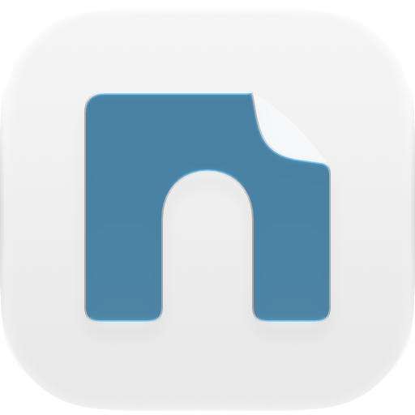
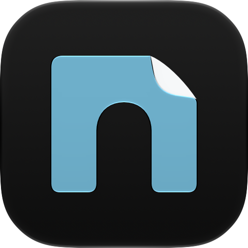
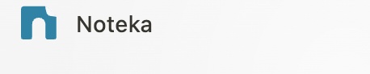
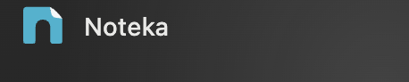
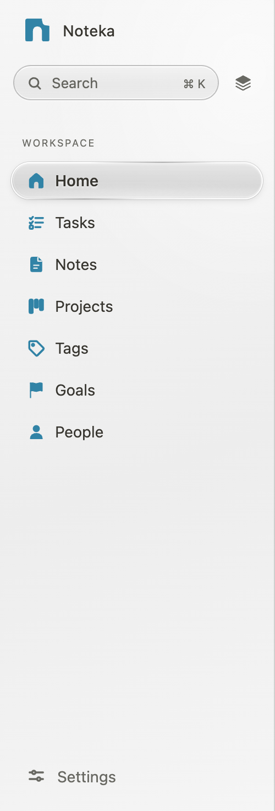
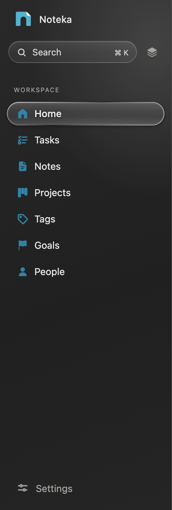
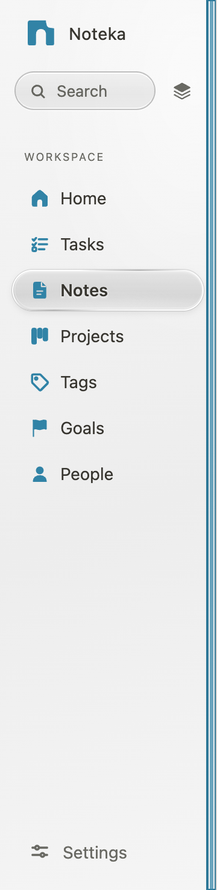
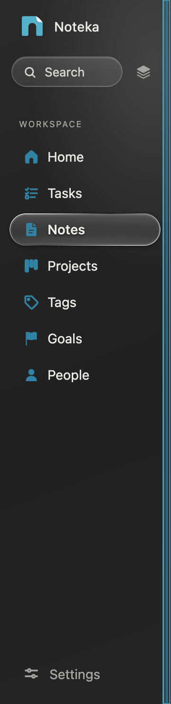
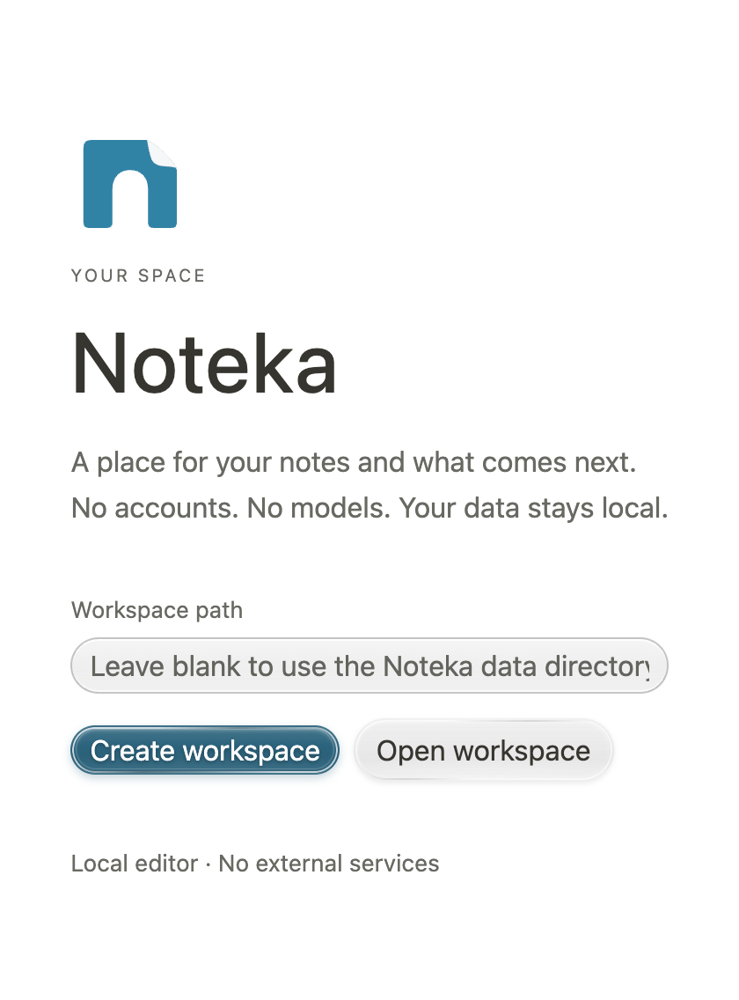
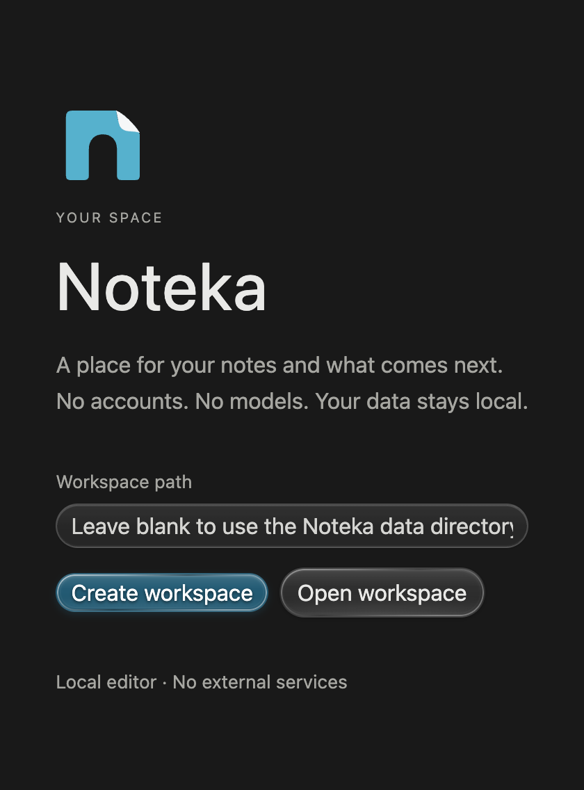

# Identidad de Noteka — referencias de producción

05/11/2026. Ver [fuentes y generación](../../brand.md) y
[verificación](../../verification-brand.md).

## Ícono nativo macOS

Exportaciones reales de `Noteka.icon` mediante `ictool` de Xcode 27.2, 512 ×
512 px; no son las simulaciones de la conversación. El sistema modifica su
material según versión, apariencia y contexto. Los archivos conservan alfa.

| Claro | Oscuro |
| --- | --- |
|  |  |

Variantes monocromas del sistema: [ClearLight](native/ClearLight.png) y
[ClearDark](native/ClearDark.png). `native/manifest.json` registra fuentes y PNG.

## Marca en la aplicación

Capturas del frontend compilado con CLI Rust real y un workspace SQLite temporal
nuevo, sin datos personales ni pantalla nativa. Playwright CLI 0.1.22,
movimiento reducido y DPR 2. Cada motor tiene un manifiesto propio con huellas,
versión, verificaciones y nombres de capturas. No acreditan IPC o composición
de WKWebView nativo ni reemplazan la evidencia del material de Apple.

| Claro | Oscuro |
| --- | --- |
|  |  |
|  |  |
|  |  |
|  |  |

Segundo motor: [WebKit](webkit/manifest.json). Contraste aumentado:
[claro](chromium/header-contrast-light.png) / [oscuro](chromium/header-contrast-dark.png).

Las referencias generales de `../liquid-glass/` conservan la marca anterior de
su fecha. Esta galería focal registra la identidad implementada sin regenerar
pantallas ajenas al cambio.
