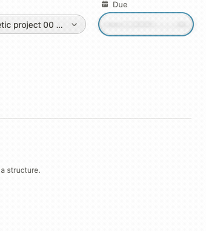
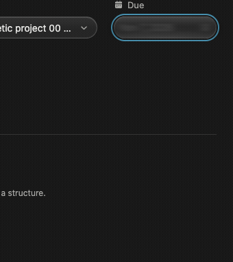
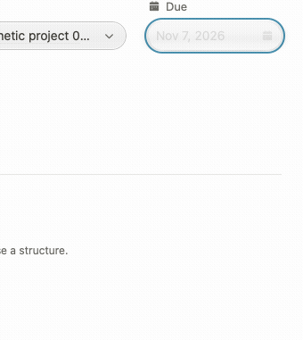
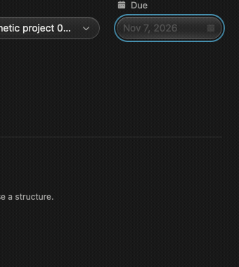

# Calendario Due: expansión desde el campo

Capturas sintéticas del build de producción, 07/11/2026. El GIF muestra ocho
fotogramas muestreados de la apertura real entre 0 y 400 ms y una pausa final;
el reinicio del loop no representa la transición de cierre. No es un video de
Apple ni de la ventana nativa de Tauri. Cada motor conserva su propia referencia.

| Motor | Claro | Oscuro |
| --- | --- | --- |
| Chromium |  |  |
| WebKit |  |  |

Los PNG `*-rest.png` muestran el estado final; `*-violet-rest.png` agrega un
segundo acento manteniendo neutro el material. Los frames individuales quedan en
`output/playwright/due-liquid-morph/<motor>/`. Datos de CLI/SQLite temporales,
viewport 1440 × 900 y recorte alrededor del campo/picker. Se pausa la animación
en el primer frame antes de avanzar su tiempo: la captura no depende de que la
máquina termine una llamada de screenshot dentro de los 400 ms de la apertura.

Reproducción desde la raíz, con el CLI Rust existente y ffmpeg para exportar GIF:

```sh
npm run build
npm run test:headless-due-picker
NOTEKA_TEST_BROWSER=webkit npm run test:headless-due-picker
node scripts/render-due-morph-preview.mjs
```

[Investigación, resultados y límites](../../verification-due-liquid-morph.md).
