# Atlas Liquid Glass de Noteka

Referencia visual de la [guía de diseño obligatoria](../../design-system.md),
consolidada el 04/11/2026. No hace falta consultar las conversaciones originales.
El material es una aproximación CSS inspirada en Apple; la ventana sigue siendo
opaca y no muestra ni refracta el escritorio.

## Procedencia

29 screenshots del frontend compilado, capturados con Chromium headless mediante
Playwright CLI 0.1.22. Corpus temporal nuevo conectado a CLI Rust real/SQLite:
Ana Torres, Alex Rivera, Studio Norte/Sur, Design system y Product brief son
fixtures ficticias. La foto de Ana es el icono local de Noteka, no una persona.
No se copiaron los adjuntos privados del usuario ni se abrió su workspace.

[manifest.json](chromium/manifest.json) registra fecha UTC, versión exacta del
motor, huellas SHA-256 de fuentes/build/PNG, tema, acento, viewport y estado de
cada captura. Viewport habitual 1440 × 900 CSS px, DPR 2, movimiento reducido;
la guardia estrecha usa 420 × 740. Los PNG recortados a un componente conservan
su resolución de captura. Las imágenes no fueron retocadas ni compuestas.

Estas imágenes muestran estados estáticos. No acreditan IPC nativo, composición
Tauri/macOS, contraste de todos los fondos posibles ni rendimiento. La portada
ASCII puede variar entre ejecuciones; no comparar el bitmap completo como un
golden test. La diferencia de blur entre WebKit headless y Chromium está
documentada en la [verificación de popups](../../verification-settings-and-search-glass.md).

## Navegación y herramientas

La selección lateral es la referencia de mayor relieve. Tabs y herramientas
reducen su intensidad; el breadcrumb es más transparente. Sólo New se tiñe.
La portada y el contenido no se convierten en paneles de vidrio.

| Claro | Oscuro |
| --- | --- |
| 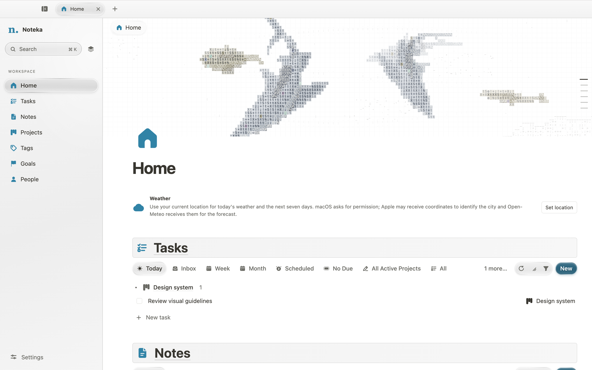 | 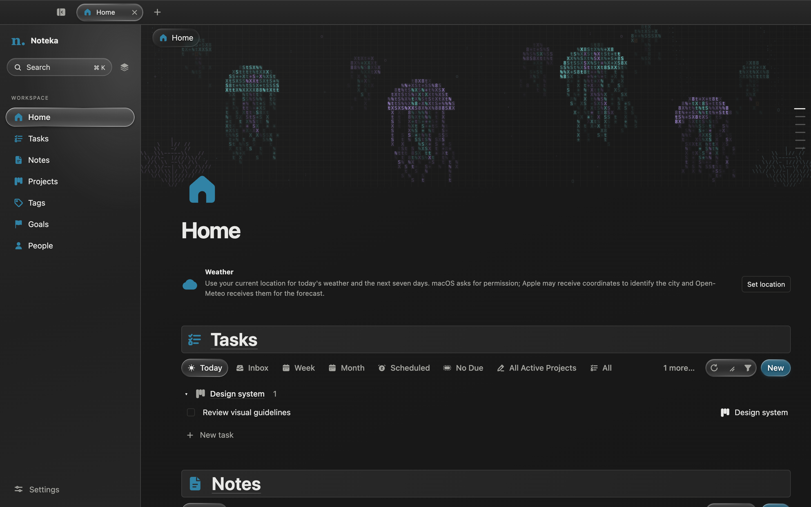 |
| 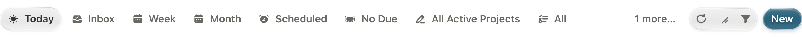 | 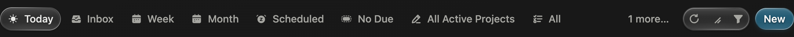 |
|  | 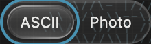 |

Detalle del sidebar: [claro](chromium/sidebar-light.png) /
[oscuro](chromium/sidebar-dark.png). Compará el Search plano con el indicador
activo elevado: comparten lineamiento, no la misma sombra ni el mismo borde.
ASCII/Photo muestra el foco deliberadamente; sus botones conservan `aria-pressed`.

## People y notas

People conserva base sólida, foto original y badges semánticos. La tarjeta de
Ana muestra foco de teclado exterior; el marco del resto permanece tenue.
En Note, Tag con un destino y Type mantienen 32 px. La cabecera agrupa controles
y las relaciones separan navegación y eliminación.

| Claro | Oscuro |
| --- | --- |
| 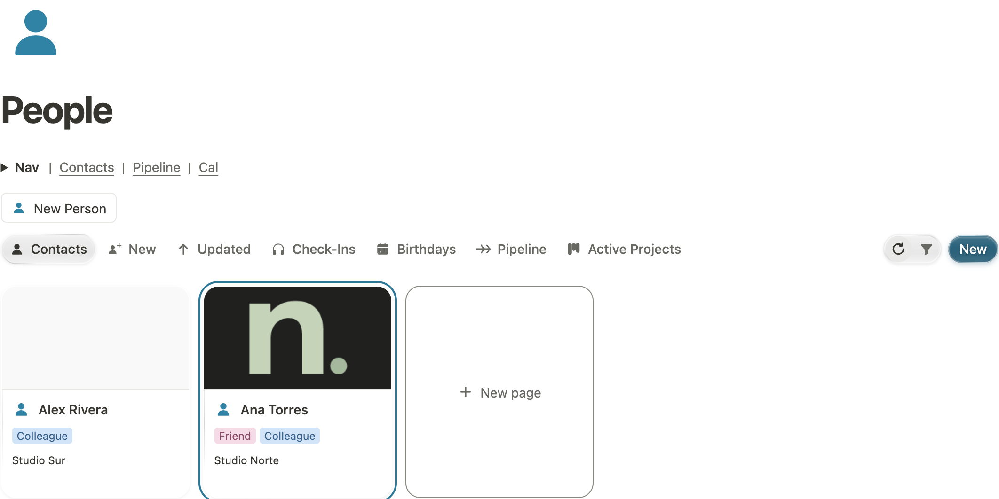 | 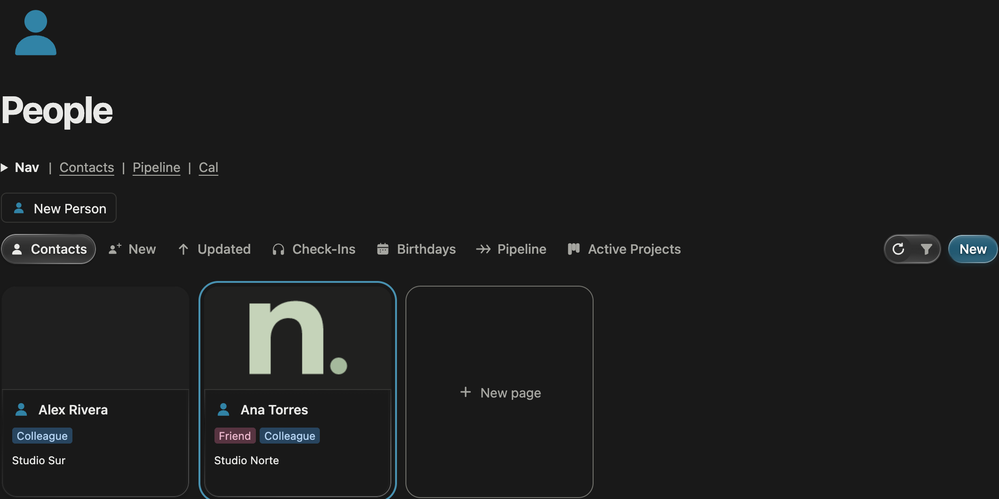 |
| 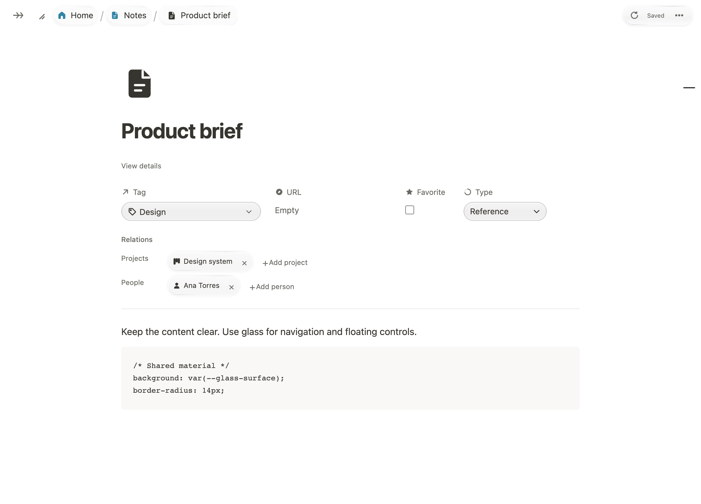 | 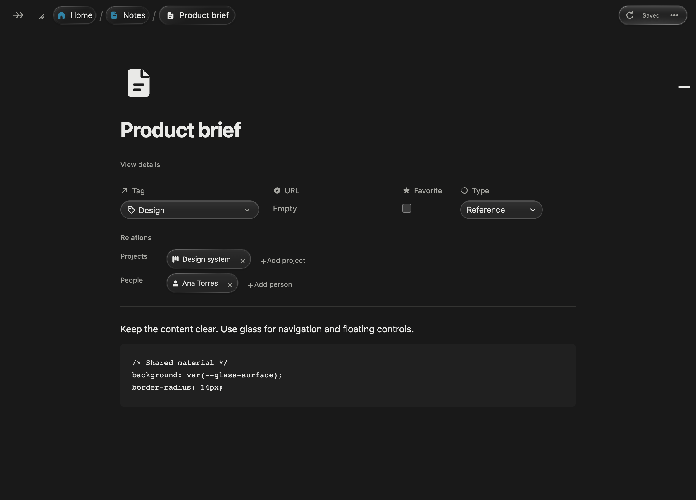 |
| 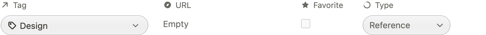 | 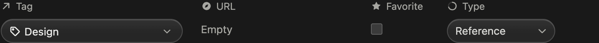 |

La tinta de Type bloqueado es secundaria; el destino Design sigue legible y
navegable. No atenuar todo el contenedor para simular disabled.

## Menús y relaciones

El marco `.glass-menu` no cambia la posición, el foco, el cierre ni la operación
del componente. El campo del picker conserva su función; no es otro popup de
búsqueda global.

| Claro | Oscuro |
| --- | --- |
| 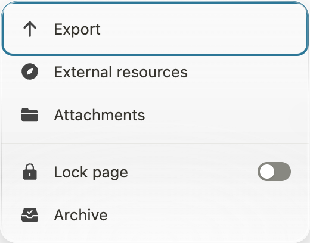 | 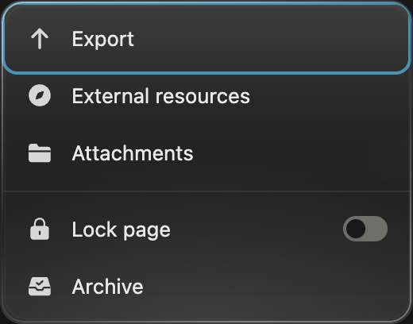 |
| 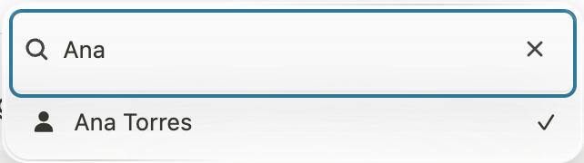 | 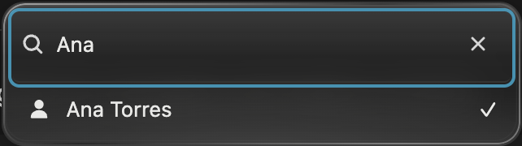 |

## Settings y Search

Ambos usan el mismo tinte/reflejo y un filtro local de 16 px; los hijos sólo
agregan velos. El campo Search repite 32 px / 13 px / peso 400 del lateral,
con su anillo de foco exterior. El fondo es el Home real del corpus sintético,
sin imágenes añadidas para fingir transmisión.

| Claro | Oscuro |
| --- | --- |
| 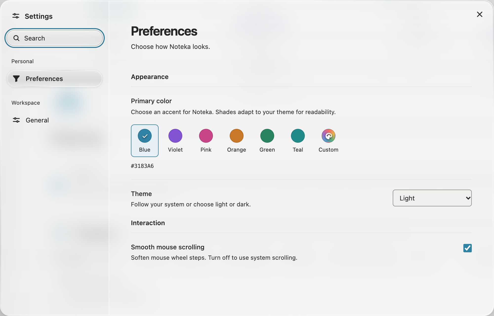 | 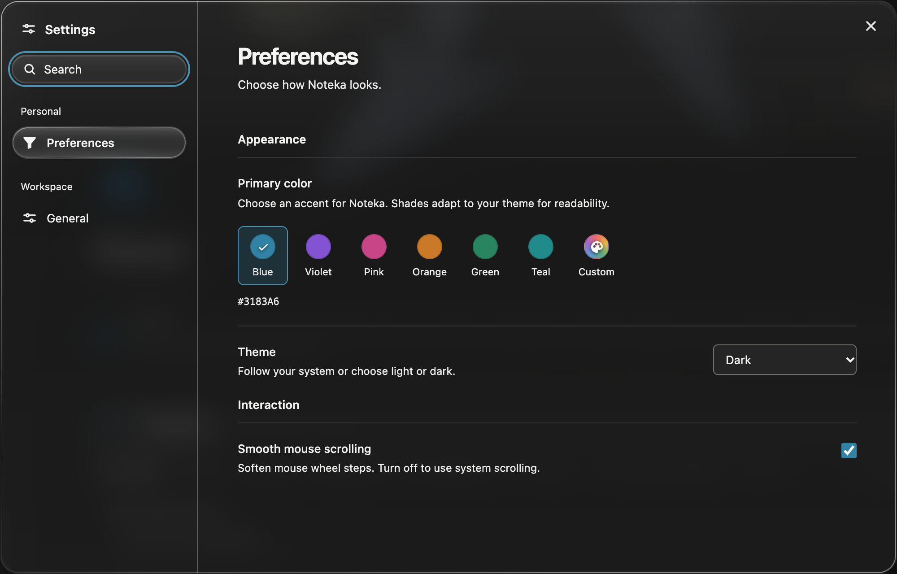 |
| 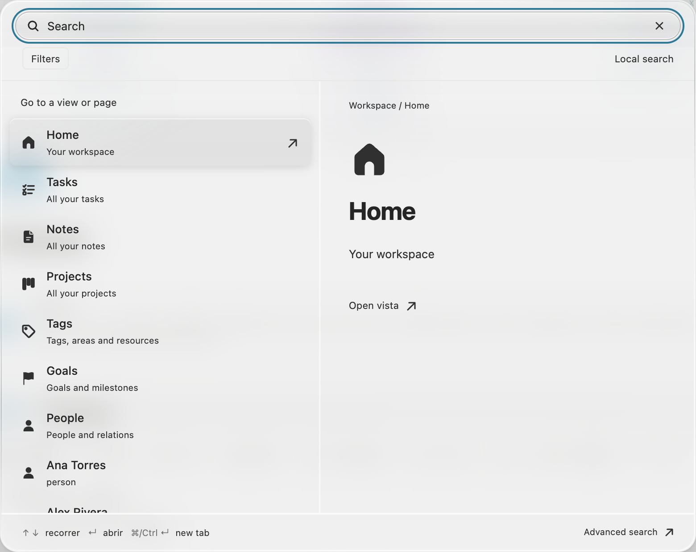 | 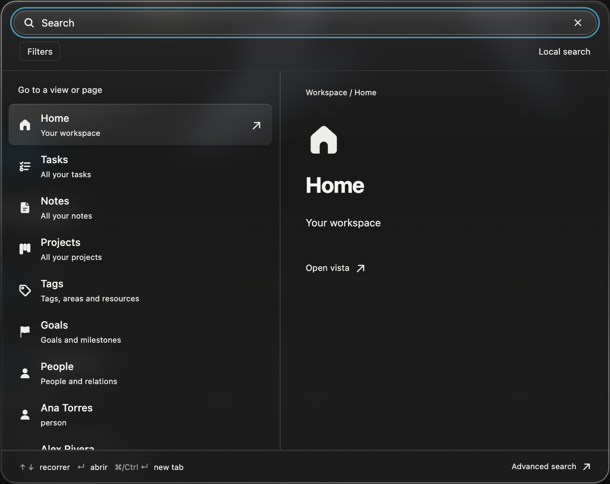 |

Sobre un fondo uniforme el vidrio puede parecer casi sólido. El borde, las
luces interiores y el contenido detrás también determinan su apariencia.
No sumar blancos o filtros en cada hijo para intentar reforzarlo.

## Guardado y alternativas accesibles

Save/Retry reutiliza la receta teñida de New, incluido el atajo blanco.
Cancel/Discard son cápsulas neutras. En la guardia, el foco inicial está en
Cancel y el clic exterior no decide qué hacer con el borrador.

| Claro | Oscuro |
| --- | --- |
| 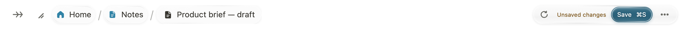 | 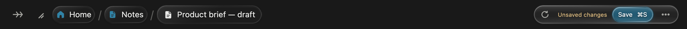 |
| 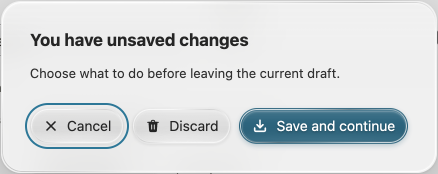 | 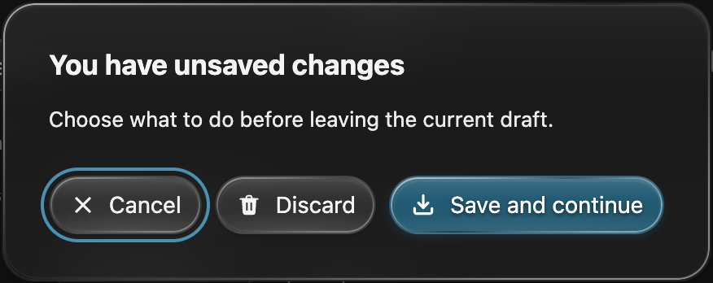 |

Segundo acento, sin teñir la cápsula de navegación:

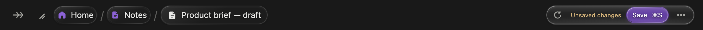

Guardia estrecha: secundarios en una fila y confirmación en la siguiente.

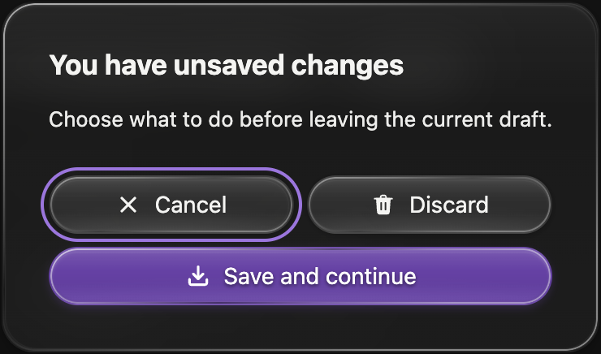

Mayor contraste elimina blur, gradientes, sombras y marcos reflectantes;
conserva superficie sólida y foco. `prefers-reduced-transparency: reduce` usa
la misma familia de fallbacks.

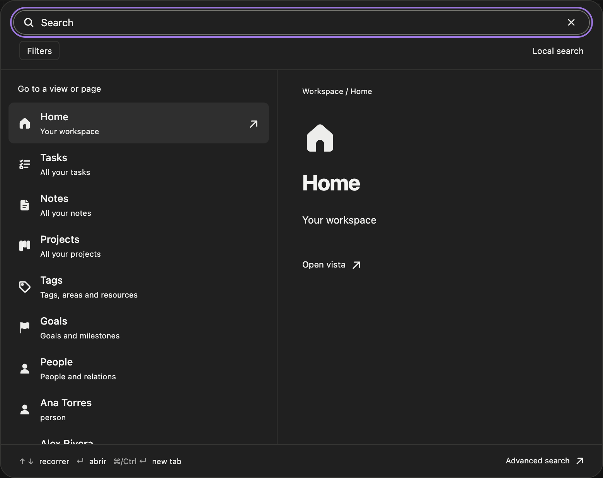

## Regeneración y revisión

Desde la raíz del repositorio, con los prerrequisitos de
[development.md](../../development.md):

```sh
npm run build
cargo build -p noteka-cli
npm run design:screenshots
```

El [runner](../../../scripts/capture-liquid-glass-guide.mjs) usa npx con CLI
fijado, crea una sesión aislada y ejecuta
[el recorrido](../../../scripts/capture-liquid-glass-guide.cjs). Si falta el
browser, instalá el motor que indique el diagnóstico de ese CLI. La opción
`NOTEKA_TEST_BROWSER=webkit npm run design:screenshots` genera una galería
independiente en `webkit/`; no reemplaza las referencias Chromium.

Primero se guardan artefactos en `output/playwright/liquid-glass-guide/`
(ignorado por Git). Sólo al completar el recorrido sin errores/solicitudes
externas se copian los PNG y el manifest a esta carpeta. El recorrido comprueba
selecciones, carga de relaciones, bloqueo, placeholder Search y fallback sin
blur; no sustituye las pruebas funcionales completas enlazadas por la guía.

Antes de versionar una regeneración, revisá el encuadre, ambos temas, fotos y
badges, alineación del Tag/flecha, legibilidad, foco y controles estrechos.
Confirmá que manifest y PNG corresponden a las fuentes actuales y que no hay
rutas de ejecución, datos privados o pantallas nativas en los assets.
