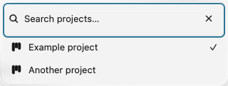
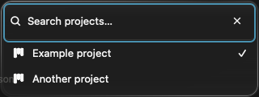

# Claridad temprana de popups — 10/11/2026

`accelerate-popup-content-reveal` reduce la fase borrosa solicitada por el usuario.
Cambio verificado localmente con sus 3/3 tareas completas, pendiente de revisión/archivo.
La capa temporal de menús/pickers vive en top layer y puede filtrar su propio
texto: adelantar únicamente la opacidad no bastaba. Su entrada ahora termina en
160 ms en vez de 400 ms y libera antes esa capa. El vidrio en reposo conserva
sus tokens, tinte y blur.

| Propiedad | Antes | Ahora |
| --- | ---: | ---: |
| Entrada de menús/pickers compartidos | 400 ms | 160 ms |
| Espera inicial de contenido de menú/Due | 120 ms | 0 ms |
| Opacidad completa de menú/Due | 320 ms | 100 ms |
| Opacidad completa de diálogos/Center peek | 220 ms | 100 ms |
| Material de diálogos/Due | 400 ms | 400 ms |
| Cierre | 200 ms | 200 ms |

Los tiempos están centralizados en `liquid-motion.ts`; la reproducción autónoma,
recortes, captura de salida interrumpida y limpieza previa se mantienen. El texto
de diálogos conserva su opacidad inicial de 24% y el recorte conforme al vidrio.
Este pedido posterior sustituye la duración uniforme anterior sólo donde indica
la tabla. No cambia datos, Rust, dependencias ni red. Sigue sin commit ni archivo.

## Verificación

- Nuevo ensayo UI → CLI Rust → SQLite sintético: 17 checks Chromium y 17 WebKit,
  ambos temas. Selector de proyectos: duración 160 ms, hijos con opacidad 1 en
  100 ms y retirada del material temporal. Settings conserva material de 400 ms
  y también alcanza opacidad 1 en 100 ms. Escape/foco, Reduce Motion y original
  intacto verificados. [Resultados y hashes](design/popup-reveal/measurements.json).
- Suite compartida de overlays: 77 checks por motor; entrada diferenciada,
  cierre/interrupción de 200 ms, guardias/buffers, preferencias, menús y viewport
  de 420 px. En WebKit se corrigió una carrera del harness al consultar el sidebar
  antes de procesarse el resize: ahora espera dos frames antes de resolver su estado.
- Due: 58 checks por motor, con una aserción adicional por tema que comprueba opacidad completa a 100 ms,
  además de posición, selección, teclado, guardado, cierre y accesibilidad.
- Build nativo normal `npm run tauri build -- --debug --no-bundle` aprobado,
  sin errores/advertencias Svelte; persiste el aviso previo de chunk Vite grande.
  App reconstruida/reabierta y selector de proyectos abierto en la aplicación
  nativa, con estado Saved y sin editar datos. Quedó listo para revisión.
- OpenSpec estricto y `git diff --check` aprobados. Los tiempos son nominales de
  animación, no garantías de entrega física de frames bajo cualquier carga.

Comandos focales:

```sh
npm run test:headless-popup-reveal
NOTEKA_TEST_BROWSER=webkit npm run test:headless-popup-reveal
npm run test:headless-liquid-overlays
NOTEKA_TEST_BROWSER=webkit npm run test:headless-liquid-overlays
npm run test:headless-due-picker
NOTEKA_TEST_BROWSER=webkit npm run test:headless-due-picker
```

Trazas y logs locales en `output/playwright/popup-reveal/`. Las capturas siguientes
son reales, sin modificar, de un corpus sintético. Los frames de 100 ms congelan
los relojes WAAPI; reposo se captura al finalizar los efectos. El cálculo de
duraciones se verifica por separado. No se incluyen capturas del workspace personal.

Antes a 100 ms: el contenido todavía tiene opacidad cero y resta una parte larga
de la fase de material:


Después a 100 ms: opacidad completa; sólo restan 60 ms nominales del morph de menú:


Estado final claro: contenido nítido, buscador, lista, geometría y vidrio preservados:



Estado final oscuro en WebKit, con el mismo comportamiento:


