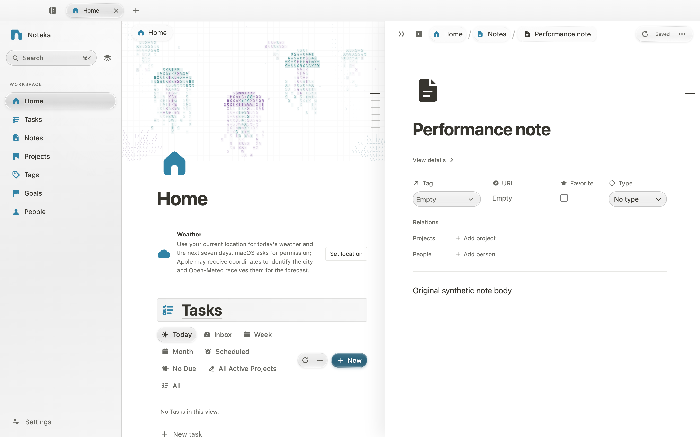
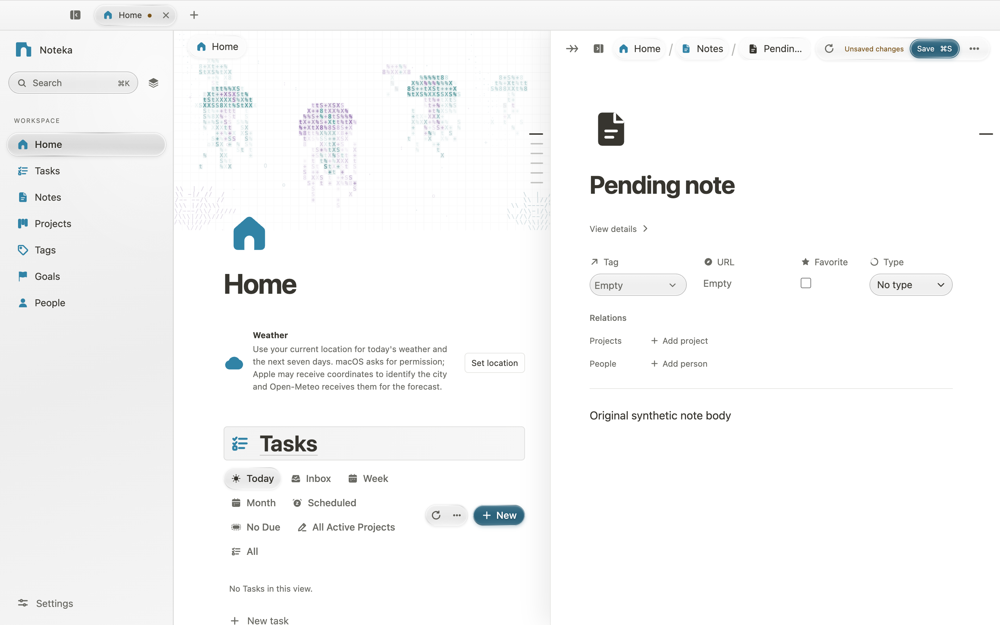
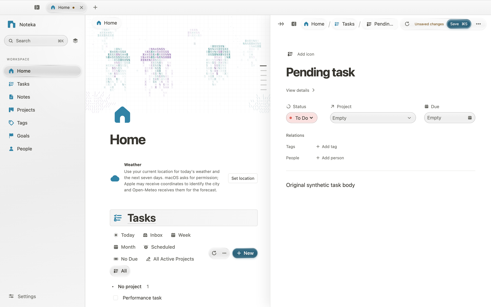
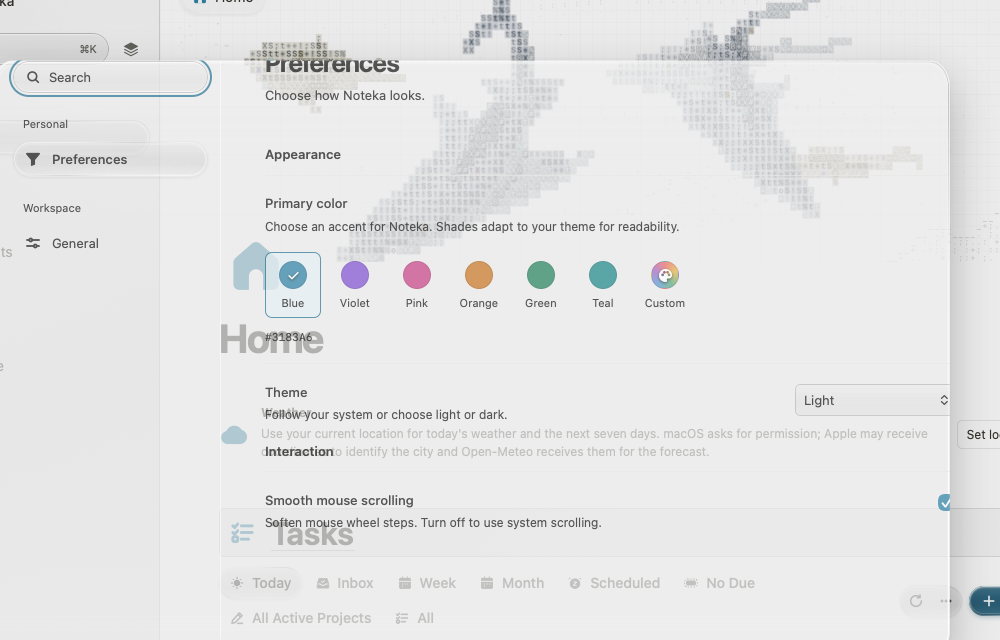
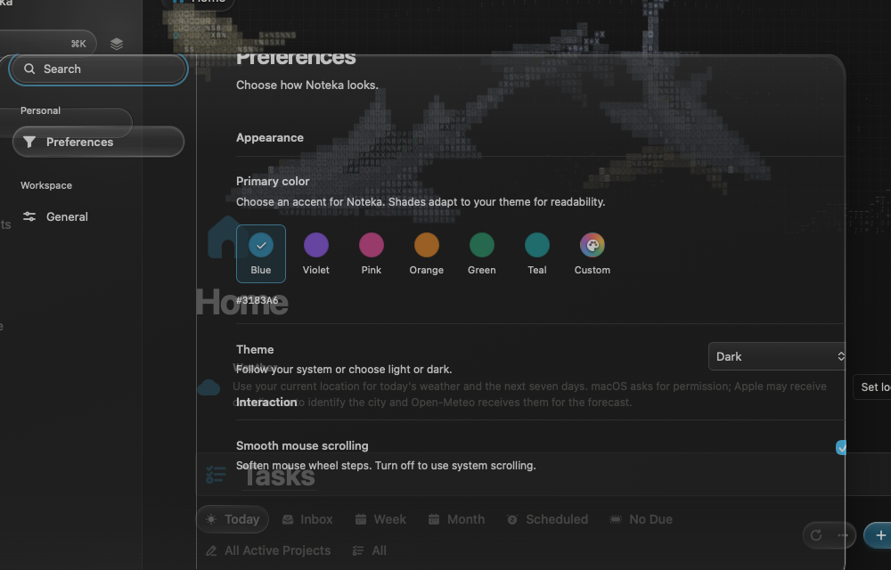

# Verificación de rendimiento de presentación — 10/11/2026

Actualización posterior del mismo día: el usuario pidió acelerar la claridad del
contenido. `accelerate-popup-content-reveal` cambia menús a 160 ms y revelado a
100 ms; las mediciones siguientes describen el estado anterior verificado.
Ver [nuevo ensayo](verification-popup-reveal.md).

El vidrio aceptado y su sistema de diseño quedaron en el commit local `3115aeb`.
`improve-native-render-scheduling` contiene optimizaciones posteriores, verificadas
localmente y todavía sin commit, push, sincronización de specs ni archivo. Se
conservaron los cambios previos de layout, clima y cadencia del checkout; no se
atribuyen a este recorte.

## Implementación

- Material, opacidad y recorte de overlays se reproducen con Web Animations.
  Los recortes se preparan al comenzar y se actualizan por resize/scroll real,
  sin mediciones de layout ni seeks de reproducción en cada tick de Svelte.
  Se conservan entrada de 400 ms, salida de 200 ms, interrupción, foco, texto
  sin escalar, preferencias y limpieza de efectos.
- La clasificación global de wheel es pasiva. Sólo una rueda discreta detectada
  arma temporalmente un listener cancelable en su scroller. Gestos finos, zoom,
  horizontal, bordes e interrupciones conservan el camino nativo. El primer
  evento real puede ser no cancelable y permanecer nativo; los posteriores
  cancelables usan el suavizado local.
- El diagnóstico de frames del canvas se publica como máximo cada 250 ms.
  Su superficie tiene contención; conserva escenas, velocidad y pausas previas.
  Durante resize conserva el buffer y lo reconstruye después de 90 ms sin cambios,
  manteniendo DPR y dimensiones finales. Puede verse escalado brevemente durante
  el cambio de ancho; no se cambia la geometría ni tipografía documental.
- Side peek conserva 260 ms y el ancho final del dueño. Desliza con `transform`
  y vuelve a `none` al asentarse para no desplazar menús fijos. Las filas entregan
  únicamente kind/title; el panel obtiene una vez el documento fresco. Relaciones,
  dashboard y recursos secundarios se leen en paralelo sin bloquear el editor.
  Generaciones, aborts y selección vigente impiden aplicar resultados obsoletos.
  No hay cambios Rust, SQLite, API, migraciones o dependencias.

## Mediciones

Corpus sintético, frontend de producción servido por el bridge de pruebas hacia
CLI Rust/SQLite reales; no sustituye IPC nativo. CLI Playwright fijado en 0.1.22.
Perfil de overlays: viewport 1440×900, DPR 2, movimiento habilitado y tema de UI
del sistema (oscuro en las capturas). El campo `theme: light` del bridge identifica
el corpus, no la preferencia visual. Medición de recortes: 1180×780, temas claros
y oscuros explícitos. Las escenas son aleatorias y los motores compartieron carga
durante parte de los ensayos: los contadores prueban trabajo eliminado, no una
tasa física de pantalla ni porcentajes causales de CPU.

Seis ciclos de Settings:

| Motor | Rectángulos antes → después | Estilos antes → después | Seeks antes → después | Mutaciones `data-frame` antes → después |
| --- | ---: | ---: | ---: | ---: |
| Chromium | 1200 → 220 | 359 → 90 | 1028 → 48 | 317 → 21 |
| WebKit | 736 → 220 | 243 → 90 | 564 → 48 | 126 → 22 |

Los seeks restantes son preparación/interrupción, no un reloj JS por frame.
Las muestras de recorte en 0, 50, 100, 180, 224, 312 y 399 ms conservaron contenido
sin transformar y un desvío máximo aproximado de 0,541 px respecto del vidrio
(umbral de aceptación 1,5 px) en ambos motores y temas.

Side peek desde una fila de Home, con una demora inyectada de 80 ms por lectura
de original y las relaciones retenidas deliberadamente:

| Motor / documento | Lecturas antes → después | Buffer de portada antes → después | Editable con metadatos pendientes antes → después |
| --- | ---: | ---: | --- |
| Chromium / nota | 2 → 1 | 15 → 1 | No → Sí |
| Chromium / tarea | 2 → 1 | 16 → 1 | No → Sí |
| WebKit / nota | 2 → 1 | 3 → 1 | No → Sí |
| WebKit / tarea | 2 → 1 | 4 → 1 | No → Sí |

Los tiempos brutos incluyen automatización, demora artificial, trazas y carga
compartida: no se presentan como latencia nativa. Se verificó cancelar el cierre
sin perder el borrador y A → B → A con un error de recursos obsoleto retenido.
El original en SQLite permaneció intacto. [Datos compactos y hashes](design/render-scheduling/measurements.json).

## Pruebas y runtime

- Build nativo normal: `npm run tauri build -- --debug --no-bundle`, exitoso;
  frontend sin errores ni advertencias Svelte. Persiste el aviso previo de chunk
  Vite mayor a 500 kB.
- Overlays: 77 checks Chromium y 77 WebKit. Recortes/render scheduling: 31 por
  motor. Smooth wheel: 20 por motor. Side peek: 19 por motor. ASCII con popups:
  10 por motor. Due: 56 Chromium, incluidos posición, teclado, guardado y resize.
- Pruebas puras de paneles, wheel y escenas/reloj: 19 aprobadas.
- El ensayo de Due falló una vez al consultar un efecto de cierre ya destruido
  bajo cuatro suites simultáneas; el pase aislado posterior completó 56 checks.
  El cambio de transform también detectó un menú fuera de viewport en WebKit;
  volver a `none` al asentarse corrigió el caso y la suite ASCII completó 10 checks.
- App normal reconstruida y reabierta con los assets finales, sin smoke mode ni
  workspace sintético. Se comprobaron apertura de tarea y nota, contenido cargado
  y estado Saved sin editar datos. La ventana final quedó en Home. No se adjuntan
  capturas del workspace personal.
- Validación OpenSpec estricta y `git diff --check` aprobados.

Comandos reproducibles focales:

```sh
npm run test:headless-render-scheduling
NOTEKA_TEST_BROWSER=webkit npm run test:headless-render-scheduling
npm run test:headless-side-peek-performance
NOTEKA_TEST_BROWSER=webkit npm run test:headless-side-peek-performance
npm run test:headless-ascii-popups
NOTEKA_TEST_BROWSER=webkit npm run test:headless-ascii-popups
npm run test:headless-due-picker
node --experimental-strip-types --test tests/panel-widths.mjs tests/smooth-wheel.mjs tests/ascii-ocean.mjs tests/ascii-cover-scenes.mjs
```

Resultados, trazas y diagnósticos locales se conservan en
`output/playwright/performance/`, `output/playwright/render-scheduling/` y
`output/playwright/side-peek-performance/`. Las trazas contienen sólo corpus
sintético. Las muestras nativas son observaciones de stacks, no benchmarks
controlados; una captura de CPU posterior coincidió con pruebas headless y se
repitió de forma aislada, sin publicar una mejora porcentual.

## Evidencia visual

Capturas reales, sin modificar, del frontend en ejecución con corpus sintético.
Las imágenes no demuestran frecuencia de frames; los contadores y pruebas
anteriores sustentan el rendimiento y la geometría.

Antes, nota abierta en Side peek:



Después, nota con borrador local conservado tras cancelar el cierre; cuerpo y
ancho final correctos, Home y portada presentes:



Después, tarea con borrador local y controles preservados:



Settings a 100 ms en WebKit, claro y oscuro: vidrio brillante y revelado progresivo
con texto sin compresión. Son frames intermedios congelados deliberadamente:




## Límites

El perfil nativo macOS 27.2 / WebKit 22625.2.8.11.9 sigue mostrando costo de
Canvas2D/getImageData e IPC gráfico. Dos experimentos locales —agrupar máscaras
en una lectura y usar OffscreenCanvas en el hilo principal— conservaron los
píxeles, pero no mejoraron tiempos y se descartaron. No se implementó un worker
ni se cambió CSP. El perfil headless WebKit mantiene intervalos RAF irregulares;
la evidencia no demuestra 60/120 Hz sostenidos ni elimina todo posible tirón.
La mejora verificada consiste en menos trabajo repetido y en quitar esperas
innecesarias de edición y scroll, conservando el ritmo y aspecto aceptados.
