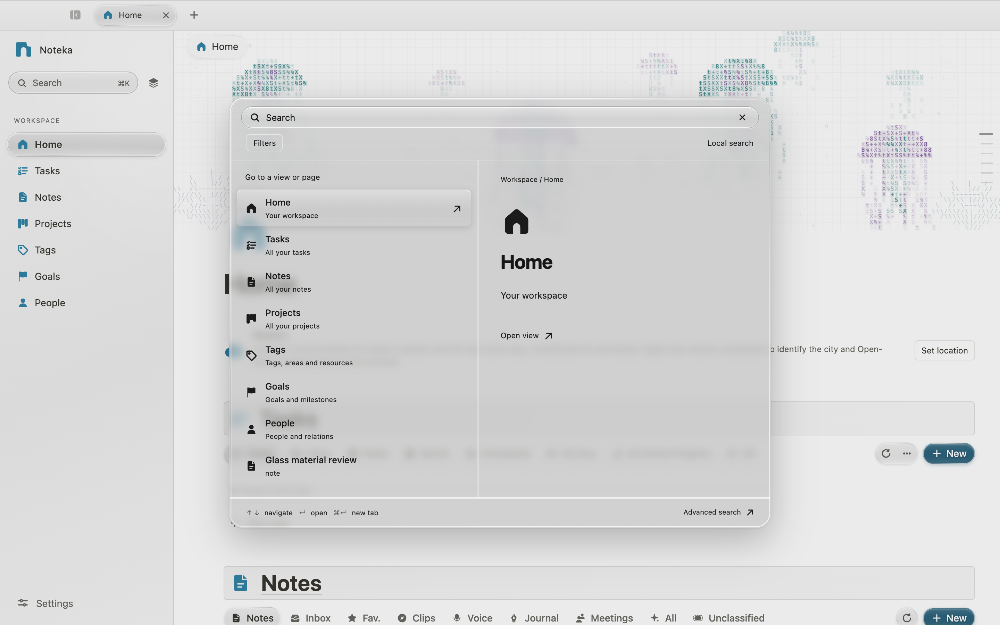

# Verificación del vidrio transparente de Search

Fecha: 10/11/2026. Cambio local `clarify-search-glass`.

Antecedente de la misma fecha: la extensión posterior
[`share-clear-popup-glass`](verification-clear-popup-glass.md) promueve esta
receta a todos los popups y sustituye la separación de Settings descrita aquí.

Search usa un tinte gris neutro, `blur(6px) saturate(1.15)` y borde/reflejos
compartidos. Resultados, preview, filtros y pie transmiten el material del
panel sin velos blancos. La selección usa los tokens de campo/navegación;
la tinta propia conserva lectura sobre los extremos medidos. Settings conserva
su receta de 24 px. Sólo cambia CSS: operaciones, datos y handlers intactos.

## Evidencia visual

Capturas sin editar del frontend compilado, CLI Rust real y SQLite temporal con
una nota ficticia. Viewport 1440×900, DPR 2; estrecho 420×740. Movimiento reducido
para capturas estables. La portada usa su escena local, que puede variar entre
ejecuciones; los encuadres no son comparaciones de píxeles de la fauna.

| Criterio | Claro | Oscuro |
| --- | --- | --- |
| Antes: velo blanco y blur 24 px | [Antes](design/search-glass/before-chromium-light.png) | [Antes](design/search-glass/before-chromium-dark.png) |
| Después: fondo reconocible, gris y contorno luminoso, Chromium | [Después](design/search-glass/after-chromium-light.png) | [Después](design/search-glass/after-chromium-dark.png) |
| Después: composición real de WebKit headless | [WebKit](design/search-glass/after-webkit-light.png) | [WebKit](design/search-glass/after-webkit-dark.png) |
| Búsqueda, filtros y preview real | [Resultados](design/search-glass/after-chromium-light-results.png) | [Resultados](design/search-glass/after-chromium-dark-results.png) |
| 420 px, sin overflow global y controles alcanzables | [Estrecho](design/search-glass/after-chromium-light-narrow.png) | [Estrecho](design/search-glass/after-chromium-dark-narrow.png) |
| Contraste aumentado: superficie sólida sin reflejos | [Sólido](design/search-glass/after-chromium-light-solid.png) | [Sólido](design/search-glass/after-chromium-dark-solid.png) |

## Verificación ejecutable

- `npm run build`: correcto; cero errores/advertencias Svelte. Vite conserva
  el aviso de bundle JavaScript mayor a 500 kB.
- Recorrido focal Playwright CLI 0.1.22: 23 checks en Chromium y 23 en WebKit;
  búsqueda local, Type, preview, selección
  con Enter y foco del destino, Escape, Close, backdrop, clic interno,
  dos temas, acentos Blue/Violet, ancho estrecho y movimiento reducido.
- Transparencia reducida: se activan las mismas media rules por CSSOM porque
  WebKit no expone esa preferencia a Playwright. Contraste aumentado se emula
  mediante la API del browser. En ambos casos el estilo calculado es sólido,
  sin filtro ni sheen. No se modifica el CSS de producto para las pruebas.
- `npm run test:headless-liquid-overlays`: 77 checks en Chromium y 77 en
  WebKit; incluye la transición 400/200 ms, limpieza y navegación de Search.
- `npx --yes @fission-ai/openspec@1.14.1 validate clarify-search-glass --strict`:
  correcto. `git diff --check`: correcto.

Contraste: tinta calculada capturada antes de ocultar sólo texto/iconos,
captura PNG del material real y luminancia sRGB/WCAG en las regiones de texto.
Fondos de prueba negro, blanco, magenta y azul detrás del diálogo; se retiran
antes de cada captura visual de producto. Se incluyen título, textos
secundarios, filas, navegación, campo y pie. No se infiere contraste del alfa.

| Motor | Mínimo claro | Mínimo oscuro |
| --- | ---: | ---: |
| Chromium | 4,61:1 | 4,84:1 |
| WebKit | 4,54:1 | 4,91:1 |

Resultados y hashes de fuentes/capturas: [manifest](design/search-glass/manifest.json).
Artefactos de trabajo locales en `output/playwright/search-glass/`: logs,
mediciones por región, recorrido focal y trazas
`after-chromium-trace.zip` / `after-webkit-trace.zip`. No contienen datos de usuario.

## Límites y observaciones

- WebKit headless transmite el fondo más nítido que Chromium aunque el filtro
  calculado sea el mismo. Se conserva esa diferencia en las capturas. No se
  verificó la composición de esta variante en una ventana Tauri/WKWebView.
- El cierre con Close devuelve foco al trigger en Chromium. En WebKit queda en
  `body`: el trigger se deshabilita al abrir y el diálogo registra foco después.
  Es una limitación del manejo de foco existente, que este cambio de CSS no
  modifica. El foco inicial, navegación dentro del modal y foco al abrir una
  página sí se verifican en ambos motores.
- No se afirma equivalencia con refracción nativa, transparencia al escritorio
  ni una mejora de CPU/GPU; no se midió rendimiento nuevo.
- Los primeros intentos del harness no instalaban el adaptador IPC de pruebas
  y contaban opciones del select Type como resultados; se corrigió el recorrido.
  La aserción de retorno al trigger expuso el límite WebKit anterior y se
  registra explícitamente; no se cambió producto para ocultarlo.
- Sin commit, publicación, sync ni archivo. Los cambios previos del checkout
  permanecen.
